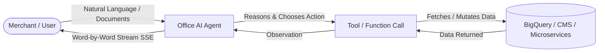
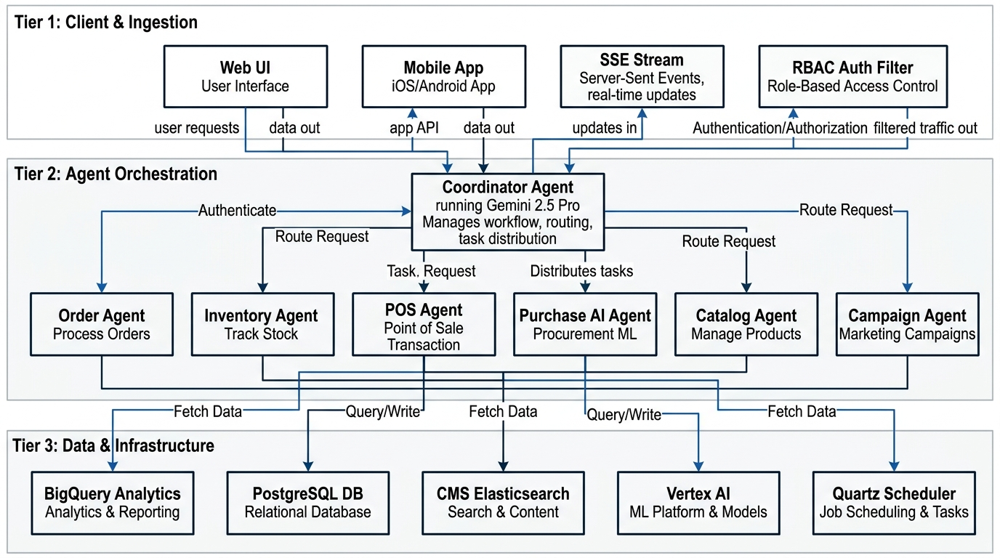
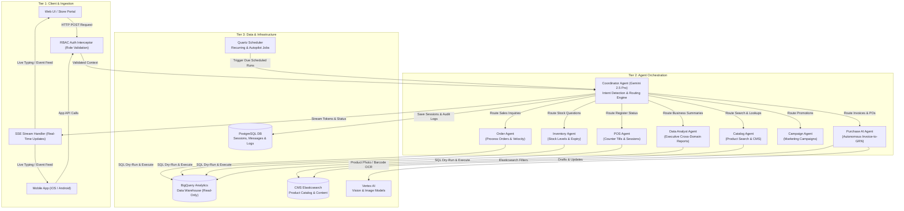
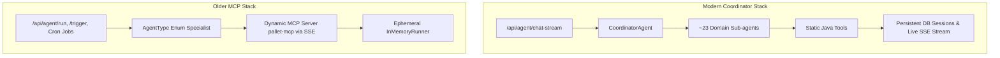
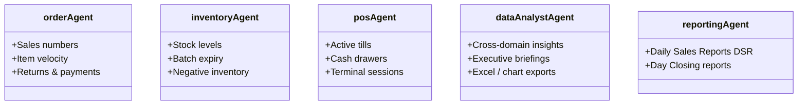
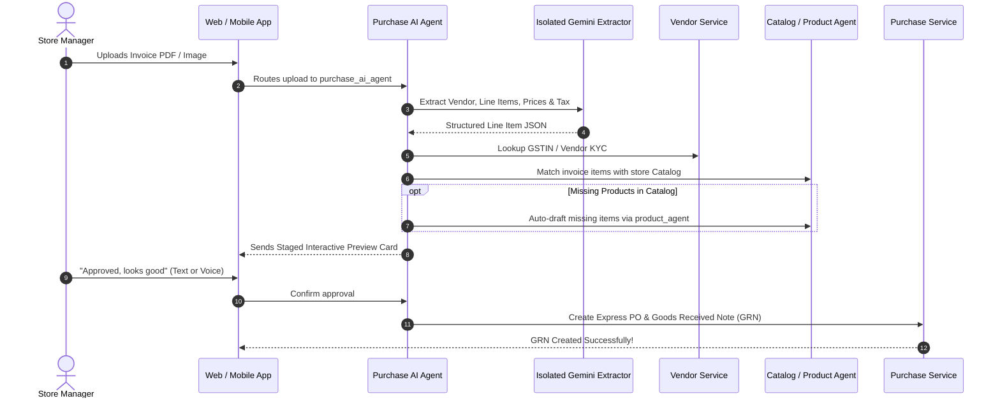
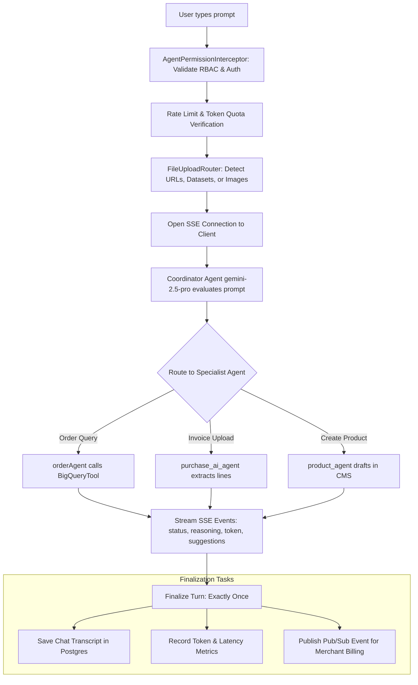
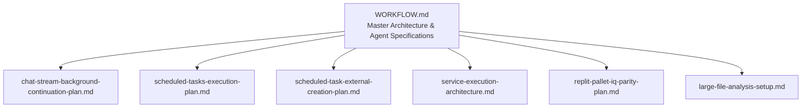

# Pallet IQ Office Agents: Architecture, Workflows & Visual Guide

Welcome to the **Pallet Office Agents** guide. This document provides an intuitive, comprehensive, and visual explanation of how the multi-agent system (`pallet-comms-agent`) operates behind the scenes in our office application (Pallet IQ).

---

## 1. Quick Start: Foundational Concepts

Before diving into workflows, here are the essential building blocks:

| Term | What it Means in Plain English |
| :--- | :--- |
| **Agent (`LlmAgent`)** | A Large Language Model (Gemini) equipped with a system prompt (instructions), memory, and a specific set of tools it is authorized to call. |
| **Tool** | A Java function that the agent can execute (e.g., query sales in BigQuery, search products in CMS, or create an invoice). |
| **Runner** | The orchestration loop: *Prompt $\rightarrow$ Agent reasons $\rightarrow$ Calls Tool $\rightarrow$ Observes result $\rightarrow$ Generates final answer*. |
| **Google ADK** | Google's **Agent Development Kit** (v1.6.0), the Java framework used to coordinate agents, sub-agents, and tools. |
| **SSE (Server-Sent Events)** | A persistent HTTP connection that lets the server stream the response chunk-by-chunk to the user interface (like typing in real time). |

---

## 2. System Architecture Overview

Below is the realistic enterprise architecture flow diagram illustrating the Client & Ingestion layer, the Central Agent Orchestration layer, and the Data & Infrastructure layer.

### Realistic Multi-Tier Flowchart

---

## 3. The Two Agent Stacks in the Codebase

One common point of confusion is that the codebase has two independent ways of executing agents:

* **Modern Coordinator Stack (Primary):** Powers chat, mobile apps, voice, and conversational scheduling. Built on Google ADK and Gemini 2.5 Pro routing to static domain specialists.
* **Older MCP Stack (Legacy):** Powers single-shot headless REST triggers (`/run`), marketing copy rewrites (`/copy/enhance`), and scheduled autopilot jobs via Model Context Protocol (MCP).

---

## 4. The Specialist Agents Catalog

Each agent is an expert in a specific office task:

### A. Data & Business Analytics (Read-Only Safety)

> [!NOTE]
> All data agents execute queries strictly against **Google BigQuery**. They have no write permissions, run dry-run scan checks to limit query costs, and have built-in execution timeouts.

* **`orderAgent`**: Answers questions like *"What were my top 10 products sold last week?"*
* **`inventoryAgent`**: Answers *"Which dairy items will expire in the next 7 days?"*
* **`posAgent`**: Directly inspects the replicated POS database to see which counters/tills are open.
* **`reportingAgent`**: Generates official store management reports (e.g., Day Closing Summary) or polls OMS report jobs.
* **`data_analyst_agent`**: Handles big-picture questions across sales, stock, and purchasing, outputting structured executive summaries and downloadable spreadsheets.

---

### B. Autonomous Purchasing: `purchase_ai_agent`

This is the most advanced agent in the system. It can convert a physical paper invoice or photo into a verified Purchase Order (PO) and Goods Received Note (GRN):

---

### C. Catalog, Marketing & Operations Agents

| Agent | Purpose | Primary Tools | Output / Safeguards |
| :--- | :--- | :--- | :--- |
| **`catalogAgent`** | Search, filter, and inspect existing products | `CatalogTool` (CMS Elasticsearch) | Read-only; compacts results for context size. |
| **`productAgent`** | Create new products from prompts or product photos | `ProductTool`, `ImageGenerationTool` (Vertex AI) | **Human-in-the-loop**: Saves items only as **DRAFT**; human approval required before publishing. |
| **`productKnowledgeAgent`** | Answers "How do I use Pallet?" | `ProductKnowledgeTool` | Searches CMS help guides and manuals. |
| **`campaignAgent` / `couponAgent`** | Launch discounts, SMS, WhatsApp campaigns | `CampaignTool`, `CouponTool` | Verified with `GuardrailsTool` against policy limits. |
| **`scheduledTaskAgent`** | Creates future/recurring jobs from natural chat | `ScheduledTaskTool` | Converts conversational schedules into cron tasks. |

---

## 5. End-to-End Chat Turn Lifecycle

Here is how one user turn travels through the backend:

### Server-Sent Events (SSE) Sent to the UI:

* `event: session` $\rightarrow$ Tells the UI the conversation ID.
* `event: status` $\rightarrow$ Shows a progress spinner (e.g., *"Querying sales database..."*).
* `event: reasoning` $\rightarrow$ Streams the agent's internal thinking to an expandable thought box.
* `event: token` $\rightarrow$ The actual text response typing out in real time.
* `event: suggestions` $\rightarrow$ Follow-up buttons for the user to click.
* `event: complete` $\rightarrow$ Seals the turn and stops the cursor.

---

## 6. What Problems Do the Other Planning Docs Solve?

In the `pallet_commos` folder, there are 6 other technical specification documents. Here is how they fit together:

1. **`chat-stream-background-continuation-plan.md` (Preventing Cancelled Runs):**
   * *Problem:* If a user asked a complex question and closed the tab or moved to another screen, the connection closed and cancelled the agent run midway.
   * *Solution:* Decoupled the generation into a background task so it finishes anyway. Added a `GET /reconnect` endpoint so when the user comes back, they immediately see the finished result or the live progress.

2. **`scheduled-tasks-execution-plan.md` (Conversational Automation):**
   * *Problem:* Merchants want to say: *"Every Monday at 9 AM, send me a sales report"* or *"Every Friday check stock and draft a PO"*.
   * *Solution:* Built a Quartz-driven scheduler that polls active tasks, replays instructions through the coordinator, supports `AUTONOMOUS` vs `APPROVAL_REQUIRED` modes, and auto-pauses tasks after 3 failures (circuit breaker).

3. **`scheduled-task-external-creation-plan.md` (API Task Creation):**
   * *Problem:* External services needed to schedule tasks without having a user type in a chat window.
   * *Solution:* Opened a non-conversational REST endpoint with an audit field `creatorType` (`AGENT` vs `EXTERNAL_SERVICE`).

4. **`service-execution-architecture.md` (Codebase Map):**
   * *Problem:* Developers need to know exactly which controller, thread pool, and service handle each API call.
   * *Solution:* Detailed reference mapping all 14 REST controllers, Quartz jobs, startup runners, and thread propagation pathways.

5. **`replit-pallet-iq-parity-plan.md` (Mobile UI Parity):**
   * *Problem:* The web dev-console showed tool status pills, thinking boxes, token usage HUDs, and inline charts, but the React Native (Expo) mobile app only supported simple text.
   * *Solution:* Phase-by-phase implementation plan mapping the complete SSE contract to React Native components (using `react-native-gifted-charts` and `react-native-markdown-display`).

6. **`large-file-analysis-setup.md` (Multi-GB Data Processing):**
   * *Problem:* Large CSV or Excel uploads crashed server memory when processed inside the web application.
   * *Solution:* Browser uploads directly to Google Cloud Storage (GCS) via a signed PUT URL, and a Python Cloud Run sandbox uses **DuckDB httpfs** to scan multi-gigabyte files via range queries without loading everything into RAM.

---

## 7. Fast Learning & Key Takeaways Cheat Sheet

1. **Safety First:** Data agents are read-only BigQuery consumers. Catalog updates are saved as drafts. Destructive actions always require human sign-off.
2. **Two LLM Tiers:** Fast questions run on **Gemini 2.5 Flash** (order, inventory, retail); complex planning, multi-step purchasing, and coordination run on **Gemini 2.5 Pro**.
3. **Resilience:** If an agent gets interrupted midway through creating an answer, it suppresses broken hallucinations and sends a clean retry notification to the merchant.
4. **Decoupled Architecture:** The background continuation engine guarantees that once a prompt is accepted, it will finish processing even if network connection drops.
