# pallet-comms-agent — In-Depth Workflow Guide

This guide explains how the service works internally. It starts with background concepts, follows one request from start to finish, and then covers every surrounding system.

Every HTTP path in this document is under the `/comms-agent` context path. The default port is `8090`.

---

## Table of Contents

- [Part 1: Background concepts](#part-1-background-concepts)
  - [1.1 What this service is](#11-what-this-service-is)
  - [1.2 Google ADK](#12-google-adk)
  - [1.3 Two kinds of agent delegation](#13-two-kinds-of-agent-delegation)
  - [1.4 SSE (Server-Sent Events)](#14-sse-server-sent-events)
  - [1.5 The two agent stacks](#15-the-two-agent-stacks)
  - [1.6 Downstream systems](#16-downstream-systems)
- [Part 2: Boot sequence](#part-2-boot-sequence)
- [Part 3: A chat turn, start to finish](#part-3-a-chat-turn-start-to-finish)
- [Part 4: Continue, reconnect & history](#part-4-continue-reconnect--history)
- [Part 5: Files, URLs & datasets](#part-5-files-urls--datasets)
- [Part 6: The specialist agents](#part-6-the-specialist-agents)
- [Part 7: The older single-agent flow (`/run`, `.../stream`)](#part-7-the-older-single-agent-flow-run-stream)
- [Part 8: Scheduled tasks](#part-8-scheduled-tasks)
- [Part 9: Autopilot jobs](#part-9-autopilot-jobs)
- [Part 10: Voice](#part-10-voice)
- [Part 11: RBAC in depth](#part-11-rbac-in-depth)
- [Part 12: Token accounting, cost & quota](#part-12-token-accounting-cost--quota)
- [Part 13: RAG memory](#part-13-rag-memory)
- [Part 14: Error handling & resilience](#part-14-error-handling--resilience)
- [Part 15: Observability & evaluation](#part-15-observability--evaluation)
- [Part 16: Database tables](#part-16-database-tables)
- [Part 17: SSE event reference](#part-17-sse-event-reference)
- [Part 18: Known pitfalls](#part-18-known-pitfalls)

---

# Part 1: Background concepts

## 1.1 What this service is

`pallet-comms-agent` is the AI brain behind Pallet's chat assistant. A merchant might type:

- *"What were my top 10 products last week?"*
- *"Create a 20% off coupon for Diwali"*
- *"How many terminals are free in this location?"*
- or upload a vendor invoice PDF

For every request, the service does four things:

1. **Routes.** It works out which specialist agent should handle the request.
2. **Acts.** It lets that specialist call real systems: BigQuery for analytics, CMS for products, the Purchase service for POs, the Coupon service for coupons, and so on.
3. **Streams.** It sends the answer back word by word over SSE.
4. **Records.** It saves chat history, token usage and cost, execution logs, and applies permissions.

Tech stack: Java 21, Spring Boot 4.0.5, Google ADK 1.6.0, PostgreSQL, Quartz, BigQuery, GCS, Pub/Sub and Vertex AI. The models are Gemini by default, with Claude and OpenAI as options.

## 1.2 Google ADK

The service does not call Gemini directly. It uses **Google's Agent Development Kit (ADK)**, which provides these building blocks:

| ADK concept | Meaning in this service |
|---|---|
| **LlmAgent** | A model, instructions (system prompt), a list of tools, and optionally sub-agents. Every specialist is an `LlmAgent`. |
| **Tool** | A Java method the model can call. ADK describes the method to the model as a function schema, using its `@Schema` annotations. When the model returns a function call, ADK runs the method and passes the result back to the model. |
| **Runner** | The loop that drives an agent: send prompt → get response → if it's a tool call, run the tool and send the result → repeat until the model produces final text. |
| **Session** | The conversation memory for the runner: an ordered list of events (user message, model text, tool call, tool result). |
| **Event** | Each step the runner emits. The service converts these events into what the UI shows. |
| **SequentialAgent / ParallelAgent** | Agents that run their children in order or at the same time. Used by the marketing pipelines. |

## 1.3 Two kinds of agent delegation

This distinction affects how answers behave:

| Mechanism | Behaviour | Where used |
|---|---|---|
| **`transfer_to_agent`** (sub-agents) | The coordinator hands the conversation to a specialist, and the specialist writes the answer. Control does **not** return to the coordinator. | Normal coordinator routing (order, inventory, product, …) |
| **`AgentTool`** (agent as a function) | A parent calls a child like a function, gets its result back, and continues. | `marketingAgent` and `purchase_ai_agent` (`TokenTrackingAgentFactory.AGENT_TOOL_ORCHESTRATORS`) |

Those two orchestrators use `AgentTool` because they run multi-step pipelines, for example marketingAgent → data pipeline → audienceAgent → createProposal. With a transfer, the pipeline would stop after the first hand-off. The model would then emit a function call that has no handler and **make up** the result, so the whole plan would be fabricated.

## 1.4 SSE (Server-Sent Events)

A chat response is a single long-lived HTTP connection. The server keeps writing named events:

```
event: session
data: {"sessionId":"8f1c..."}

event: status
data: {"status":"progress","tool":"runQuery","message":"Querying sales data…"}

event: token
data: {"chunk":"Your top selling"}

event: complete
data: {"status":"SUCCESS"}
```

The UI appends each `token` chunk as it arrives, which is why the answer appears to type out.

The service uses Spring MVC's **`SseEmitter`**, not a reactive `Flux`, because Tomcat can buffer reactive SSE output and deliver it in bursts. The reconnect endpoint also sets the `X-Accel-Buffering: no` and `Cache-Control: no-cache` headers, so nginx-style proxies don't buffer it either.

## 1.5 The two agent stacks

The codebase contains two independent ways of running agents. This is the most common source of confusion.

| | **Coordinator stack (main)** | **AgentType / MCP stack (older)** |
|---|---|---|
| Used by | `/chat-stream`, `/chat-stream/continue`, voice, scheduled tasks | `/run`, `/copy/enhance`, `/trigger`, audience/proposal/budget/SEO endpoints, autopilot jobs |
| Agent | One `coordinator-agent` routing to about 23 sub-agents | One specialist per `AgentType` enum value |
| Built in | `AgentWiring` + `agents/CoordinatorAgent.java` | `config/AgentConfig.java` |
| Tools | Static Java classes in `tools/`, configured at boot | Fetched at runtime from the **MCP server** (pallet-mcp) over SSE |
| Tool scoping | Set when each agent is built | `AgentType.allowsTool(...)` namespace filter |
| Runner | `Runner` + `DatabaseSessionService` (persisted) | `InMemoryRunner` (per run) |
| Entry class | `ChatStreamController` / `AgentRunner.executeCoordinator` | `AgentRunner.execute` / `runFromSession` |

Some agents share a name across the stacks, such as `product_agent`, but they are wired, prompted and tooled separately.

## 1.6 Downstream systems

| System | Used for | Config |
|---|---|---|
| **BigQuery** | All analytics (orders, inventory, purchase, retail, POS, business) | `GCP_PROJECT_ID`, `GCP_CREDENTIALS_PATH` |
| **GCS** | Report exports, signed upload/download URLs | `REPORT_GCS_BUCKET` |
| **MCP server** (pallet-mcp) | Tools for the older stack (campaign, audience, seo, budget, proposal, …) | `COMM_SERVICE_MCP_URL` |
| **Comms service** | Campaigns, templates, audiences, preferences | `COMM_SERVICE_BASE_URL`, `COMMS_SERVICE_URL` |
| **Coupon service** | Coupons | `COUPON_SERVICE_URL` |
| **CMS** | Products, catalog search, product knowledge, website builder | `CMS_SERVICE_URL` |
| **Purchase service** | Express PO / GRN, returns, indents, stock transfers | `PURCHASE_SERVICE_URL` |
| **Vendor service** | Vendor create/update/lookup, GST KYC | `VENDOR_SERVICE_URL` |
| **OMS** | Named business reports (DSR, day closing, margin, tax, …) | `OMS_SERVICE_URL` |
| **Reporting service** | Ad-hoc SQL/BigQuery report jobs | `REPORTING_SERVICE_URL` |
| **Inventory / Retail services** | Inventory and retail operations | `INVENTORY_SERVICE_URL`, `RETAIL_SERVICE_URL` |
| **Auth service** | User roles for RBAC | `AUTH_SERVICE_URL` |
| **AI usage service / Pub/Sub** | Token quota checks, consumption events | `PUBSUB_TOPIC_ID` |
| **Tavily** | Web research (product agent, SEO) | `TAVILY_API_KEY` |
| **Google Maps** | Geocoding for weather | `GOOGLE_MAPS_API_KEY` |
| **Vertex AI** | Image generation, and optionally Gemini/Claude via service account | `VERTEX_IMAGE_MODEL_URL`, `GOOGLE_GENAI_USE_VERTEXAI` |
| **OpenAI** | Optional chat model, voice Realtime | `OPENAI_API_KEY` |

---

# Part 2: Boot sequence

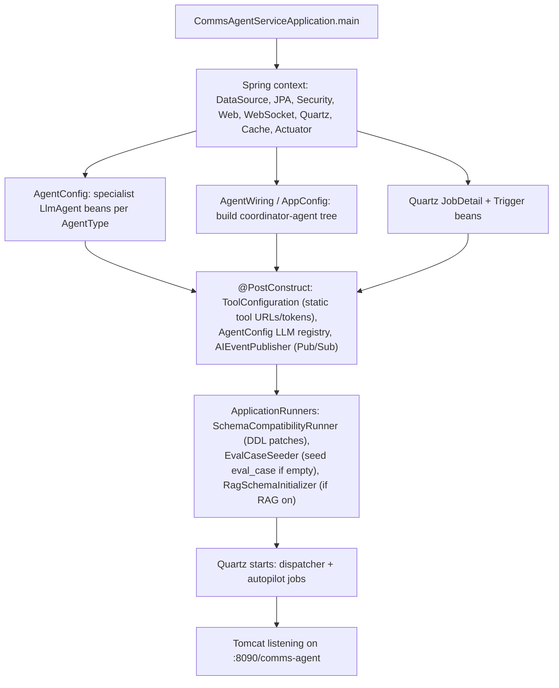

Step by step:

1. **`CommsAgentServiceApplication.main()`** starts Spring with `@EnableAsync`, `@EnableScheduling` and `@ComponentScan("com.pallet.*")`.

2. **Infrastructure beans are created:**
   - Hikari pool to Postgres (`AGENT_DB_URL`, schema `reach_agent`)
   - JPA/Hibernate with `ddl-auto: update`
   - Spring Security. `SecurityConfig` allows every request; the real checks are the RBAC interceptor and the service JWT filter.
   - WebSocket (`VoiceWebSocketConfig` registers `/ws/voice`)
   - Quartz (in-memory store, 4 threads)
   - Caffeine cache and actuator/Prometheus

3. **`AgentConfig`** creates one `LlmAgent` bean per `AgentType` for the older stack: SEO family, CAMPAIGN, BUDGET, PROPOSAL, AUDIENCE_GENERATOR, COPY_ENHANCER, insight agents, and others.

4. **`AgentWiring` / `CoordinatorAgent.build()`** assembles the coordinator tree **once**:
   - The coordinator runs on **gemini-2.5-pro**. Flash sometimes returns an empty routing turn.
   - Its instructions contain numbered routing rules, for example rule 14 (catalog search → `catalog_agent`), rule 14a (create or update a product → `product_agent`) and rule 16 (read-only PO/GRN status → `purchaseAgent`).
   - It deliberately does **not** apply the shared `thinkingConfig` with `includeThoughts=true`. Routing doesn't need thoughts returned, and pro already thinks by default. Sub-agents keep the thinking config.
   - Sub-agents: `orderAgent, inventoryAgent, retailAgent, weatherAgent, eventHolidayAgent, imageAgent, couponAgent, audienceAgent, offerAgent, templateAgent, campaignAgent, marketingPlanPipeline, websiteBuilderAgent, catalogAgent, productAgent, dataAnalystAgent, purchaseAgent, taskAgent, productKnowledgeAgent, purchaseAiAgent, reportingAgent, scheduledTaskAgent, posAgent`.

5. **`@PostConstruct` hooks:**
   - **`ToolConfiguration.configureStaticTools()`** gives every static tool class its base URL and token: CMS, Purchase, Vendor, OMS, Reporting, Coupon, the BigQuery project/credentials/scan limit/timeout, the GCS report bucket, and so on. Tools are static classes, not Spring beans, because ADK builds function tools from static methods. This is also why `ProductViewController` can reuse `ProductTool` without injecting it.
   - **`AgentConfig.registerLlmWithApiKey()`** registers Gemini models with ADK's `LlmRegistry`.
   - **`AIEventPublisher.init()`** opens the Pub/Sub publisher for usage events.

6. **`ApplicationRunner`s:**
   - **`SchemaCompatibilityRunner`** applies idempotent DDL that Hibernate `update` can't: dropping `NOT NULL`, widening `CHECK` constraints, and changing `scheduled_task*` primary keys from `uuid` to `varchar(64)` so prefixed IDs like `TASK-000123` fit.
   - **`EvalCaseSeeder`** fills `eval_case` from `static/eval/golden-cases.json`, **only when the table is empty**, so edits made in the UI survive restarts.
   - **`RagSchemaInitializer`** creates pgvector tables when `RAG_ENABLED=true` and `RAG_BACKEND=pgvector`.

7. **Quartz starts.** Spring Boot finds every `JobDetail`/`Trigger` bean. `AutopilotScheduler` declares the `SpringBeanJobFactory`, so jobs get their dependencies injected.

8. **Tomcat starts listening.** The service is now ready for traffic.

> The `db/migration/V1..V8` SQL files document the schema, but **Flyway is not wired in**. The live schema comes from Hibernate plus `SchemaCompatibilityRunner`.

---

# Part 3: A chat turn, start to finish

This part follows one message, **"Show me last week's top selling items"**, sent from the web app.

## 3.1 Overview diagram

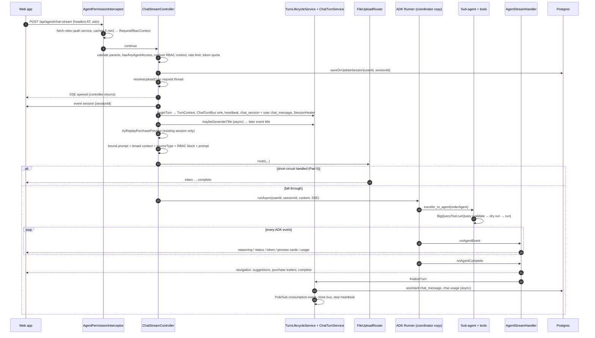

## 3.2 Step 1: The request

```
POST /comms-agent/api/agent/chat-stream
Content-Type: multipart/form-data
Headers:
  AT:   <user access token>
  uidx: <user id>

Params:
  userId=U1                (required)
  orgId=RET_82             (required)
  locationId=RLC_83        (required)
  prompt=Show me last week's top selling items   (required)
  userName=Dinesh          (optional)
  requestSessionId=<uuid>  (optional — omit for a new chat)
  file=<multipart>         (optional)
  gcsObjectRef, gcsFileMime (optional — large files uploaded via signed URL)
  sourceType=...           (optional — which screen/source the request came from)
  model=claude-sonnet-5    (optional — per-request model override)
  accessToken=...          (optional — alternative to the `at` header)
```

## 3.3 Step 2: The RBAC interceptor

`AgentPermissionInterceptor` runs **before** the controller method:

1. Reads the `AT` and `uidx` headers, plus optional `X-Org-Id` / `X-Location-Id`.
2. Calls the **auth service** (`AUTH_SERVICE_URL` + `/v1/user/roles/`) for the user's roles, through `AuthIdentityClient`. The response is cached for `RBAC_CACHE_TTL_MINUTES` (5) with up to `RBAC_CACHE_MAX_SIZE` (1000) entries.
3. Stores the roles in **`RequestRbacContext`**, a request-scoped bean.
4. With `RBAC_ENABLED=false`, it lets every request through. The local test scripts use this.

Part 11 covers RBAC in full.

## 3.4 Step 3: Controller checks

Inside `ChatStreamController.streamChatWithFile`:

1. **Parameter check.** `userId`, `orgId` and `locationId` must not be blank, or the request fails with `IllegalArgumentException` → **400**.
2. **Access check.** `permissionService.hasAnyAgentAccess()` must be true, or the request fails with `AgentServiceException(FORBIDDEN, "You do not have permission to use chat.")` → **403**.
3. **Capture RBAC now, on the request thread.**
   - `buildAllowedAgentsContext()` returns a text block for the prompt listing the agents this user may use.
   - `getAllowedCoordinatorAgentNames()` returns the set of sub-agent names to keep.

   Both have to be read here. `RequestRbacContext` is request-scoped and **can't be accessed from the SSE worker thread**.
4. **Access token.** `resolveAccessToken(accessToken, at)` picks whichever was supplied.
5. **Rate limit.** `rateLimiter.tryAcquire(userId)` returns **429** `RATE_LIMITED` when exceeded. It's off by default (`agent.ratelimit.enabled=false`), allows 60 requests per 60s per key when on, and lets requests through if the limiter fails.
6. **Token quota.** `aiTokenQuotaService.validate(orgId, locationId)` blocks the request when the org or location has no AI tokens left.

## 3.5 Step 4: Session identity

- If `requestSessionId` is present, this message **continues** that chat. If not, a new `UUID` becomes the chat ID.
- `turnLifecycle.saveOrUpdateSession(userId, sessionId)` upserts the `user_session` row. It **loads the existing row first**, because saving a new entity over an existing ID issues an UPDATE that nulls `created_at` and violates NOT NULL.

## 3.6 Step 5: Capture the upload

`resolveUpload(file, prompt)` reads the following **on the request thread**:

- `bytes`: `fileIngestionService.readBytes(file)`
- `name`: the original filename
- `mimeType`: `fileIngestionService.resolveUploadMime(file)`, which inspects content as well as the declared type
- `intent`: `UploadIntent.of(prompt, mimeType)`, which classifies what the user wants, such as `imageNeedingDescription()` or `spreadsheetNeedingAnalysis()`

This has to happen now because **Spring deletes multipart temp files once the controller method returns**, and with SSE it returns almost immediately.

## 3.7 Step 6: Open the stream

1. An `SseEmitter` is created with `agent.sse.stream-timeout-ms` (**900000 ms = 15 min**). Deep reasoning plus BigQuery can take minutes.
2. `emitter.onTimeout` sends a `TIMEOUT` error ("The request timed out… try a smaller file or a more specific prompt") and completes.
3. `streamWriter.runOnSse(emitter, …)` submits the work to a **bounded SSE pool**: `max-concurrent-streams: 200`, `queue-capacity: 100`. Beyond that, requests are rejected with an **OVERLOADED** error.
4. The controller **returns the emitter**. Everything below runs on a worker thread.

## 3.8 Step 7: The first events and turn setup

1. **`event: session {sessionId}`** goes out immediately, so a new chat can appear in the sidebar.

2. **`turnLifecycle.beginTurn(...)`** → `ChatTurnService.begin(...)`:
   - Creates a **`SessionUsage`** whose callback sends `usage` SSE events.
   - Creates a **`TurnContext`**, the in-memory state for this turn:
     - `emitter`, `sessionId`, `userId`, `userName`, `orgId`, `locationId`
     - `usage`: the token accumulator
     - `answer()`: the visible answer rebuilt from the tokens sent
     - `backgroundable`: whether a live ADK run is in progress
     - `clientGone`: whether the client disconnected
     - `finalized`: an `AtomicBoolean` so finalisation runs once
     - `subscription`: the ADK run's `Disposable`
     - `heartbeatTask`, `startedAtNanos`, `ragHitsJson`
   - Registers it in **two maps**: `turns` (by emitter) and `turnsBySession` (by sessionId). The sessionId map is what reconnect uses.
   - Opens a **`ChatTurnBus` sink** for the session. Every event written to the emitter is **also written to this bus**, so a reconnecting client can subscribe. The sink is opened even if the turn ends up on a short-circuit path, where it's simply closed again.
   - Registers emitter callbacks:
     - `onCompletion` → `onEmitterEnded(ctx)`
     - `onError` → `onEmitterEnded(ctx)`
     - `onTimeout` → `endStream(ctx)`
   - **`startHeartbeat(ctx)`** sends periodic `heartbeat` events so proxies and load balancers don't close a quiet connection during long BigQuery work. The UI ignores them.
   - Writes **`chat_session`** (created if new) and the **user `chat_message`** (prompt, file name, file type). These writes are best-effort: a history failure is logged and the chat continues.

3. **Session healing** (`healSessionIfNeeded`):
   - Loads the stored ADK session through `DatabaseSessionService`.
   - If an earlier run was abandoned in the middle of a tool call, the history has a **function call with no matching response**. Gemini rejects a history like that.
   - `SessionHealer.danglingCalls(...)` finds them, and `SessionHealer.repairEvents(...)` adds **synthetic responses**, so the next replay is valid.
   - Also best-effort.

4. **Title** (`maybeGenerateTitle`), for new chats only:
   - `TitleGeneratorService.generateAsync(prompt, …)` asks a model for a short title **in the background**.
   - When it's ready, the title is saved (`chatHistoryService.updateTitle`) and sent as `event: title {sessionId, title}`, so the sidebar updates live.
   - It used to block the turn for up to 6 seconds. It now runs alongside the answer.

## 3.9 Step 8: Purchase preview replay

For an existing session, `tryReplayPurchasePreview(emitter, sessionId, prompt)` checks whether the message only confirms or re-displays a **purchase preview that's already cached** (`PurchasePreviewCacheService`). If so, it sends the cached cards and completes **without calling the LLM**.

## 3.10 Step 9: Building the prompt

The model receives one text with these parts:

```
[TenantPromptBuilder.boundContext]
  org_id=RET_82, location_id=RLC_83, user_id=U1, user_name=..., access token ...
[promptAssembler.appendSourceTypeContext]   (only if sourceType given)
[RBAC allowed-agents block]
  "This user may only use: order analytics, inventory, ..."
[optional "[CROSS_DOMAIN_ANALYST_DISABLED] " prefix]
Show me last week's top selling items
```

- The **prefix** is added only when `CROSS_DOMAIN_ANALYST_ENABLED=false`. That's a production kill switch: the coordinator's rules then keep analytics questions on single-domain specialists instead of `data_analyst_agent`. Exports still use the analyst.
- Tenant identity comes from the **server**, never from model output. For RAG and some tools it's held in ThreadLocals such as `RagContext`, so the model can't change it. This protects against prompt injection.

## 3.11 Step 10: Short-circuit routing

`fileUploadRouter.route(analysisPort(emitter), upload, sessionId, prompt, boundPrompt, userId)` checks four cases (Part 5). If one handles the turn, the method returns here. For a plain text question like ours, none match.

## 3.12 Step 11: Building the per-request agent tree

1. **`FileContentAssembler.assemble(...)`** builds the ADK `Content`: the bound prompt text, plus inline file parts and uploaded-file or photo notes when a file is attached.
2. **`RunConfig`**: `autoCreateSession(true)`, `streamingMode(SSE)`.
3. **`getAdkRunner(ctx.usage, modelFactory.resolveRequested(model), rbacAllowedAgentNames)`**:
   ```java
   Runner.builder()
       .agent(tokenTrackingAgentFactory.rewrite(coordinatorAgent, usage, modelOverride, allowedAgentNames))
       .appName("pallet-agent")
       .sessionService(databaseSessionService)
       .build();
   ```

### What `TokenTrackingAgentFactory.rewrite` does

It builds a **copy of the whole coordinator tree for this request**:

- **LlmAgent:** copies name, description, planning, includeContents, instruction, globalInstruction, generateContentConfig, outputKey and input/output schemas, then:
  - **Model:** the request's `model` override wins over the agent's own model. `ModelFactory.applyModel` picks Claude, OpenAI or a **usage-tracking Gemini**, with a usage consumer bound to `(agentName, model)` in this request's `SessionUsage`. A non-Gemini model object is kept as-is, so the Gemini client doesn't try to resolve a Claude ID.
  - **Tools:** the tools the agent was built with are kept.
  - **Sub-agents:** rewritten recursively. Sub-agents **not** in `allowedCoordinatorAgentNames` are **removed**, which is the actual RBAC enforcement.
  - For `marketingAgent` and `purchase_ai_agent`, children are wrapped as `AgentTool`s (§1.3).
- **SequentialAgent / ParallelAgent:** rebuilt with rewritten children.
- **Other agent types:** left untracked and logged at debug.

Why a copy per request: each copy's model wrapper **closes over its own `SessionUsage`**, so token counts stay correct under concurrency without ThreadLocals that could be lost across RxJava thread switches.

### What `DatabaseSessionService` does

It's a custom ADK `BaseSessionService`:

- Holds sessions in an `InMemorySessionService`.
- On **`appendEvent`**, it also serialises the whole session to JSON and saves it in **`adk_session_state`**.
- On **`getSession`** when the session isn't in memory (after a restart, or on another instance), it loads the JSON, recreates the session with the same appName, userId, state and sessionId, and **replays every event** into memory.
- On `deleteSession`, it deletes from both.

This is how a follow-up message days later still has the full conversation context.

## 3.13 Step 12: Starting the run

```java
ctx.backgroundable = true;
if (ctx.finalized.get()) return;   // race guard
StreamingTurn turn = new StreamingTurn(emitter, ctx, userId, sessionId, prompt, "CHAT-STREAM-FILE");
ctx.subscription = runner.runAsync(userId, sessionId, content, config)
        .subscribe(e   -> agentStreamHandler.onAgentEvent(turn, e),
                   err -> agentStreamHandler.onAgentError(turn, err),
                   ()  -> agentStreamHandler.onAgentComplete(turn));
```

- **`backgroundable = true`**: from here on, if the user closes the tab, the run **keeps going** and saves its answer.
- **Race guard**: if the client disconnected during setup, `onEmitterEnded` has already finalised the turn. Starting the run then would write into a context that can never be saved again, so the method returns.
- **`StreamingTurn`** holds per-run streaming state: the pending text buffer, the suggestions-seen flag, emitted text, last agent seen, abnormal finish reason, and the URL of any produced file.

## 3.14 Step 13: Inside the agents

1. **The coordinator** (gemini-2.5-pro) reads its routing rules. This is a single-domain sales question, so it calls `transfer_to_agent("orderAgent")`.

2. **orderAgent** (gemini-2.5-flash by default, `ORDER_AGENT_MODEL` to override) has instructions about the order dataset (`OrderAnalyticsInstructions`) and uses `BigQueryTool`:
   - `listDatasets` / `listTables` / `getTableSchema` to find columns when needed. `SchemaKnowledge` provides built-in schema hints so it doesn't explore every time.
   - It writes GoogleSQL and calls **`runQuery(sql)`**.

3. **Inside `BigQueryTool.runQuery`**, three safety steps:

   | Step | What happens | Why |
   |---|---|---|
   | **A. Validate** | The query must start with `SELECT` or `WITH`, otherwise it's rejected: "Only read-only SELECT or WITH CTE queries are allowed." | Agents can never modify data |
   | **B. Dry run** | BigQuery estimates `totalBytesProcessed` without running. Above `BIGQUERY_QUERY_MAX_BYTES` (100 MB by default), it's rejected: "Query scans too much data… add partition columns or date filters." | Prevents runaway cost. The model usually rewrites the SQL and retries. |
   | **C. Real run** | Executes with `setJobTimeoutMs(BIGQUERY_QUERY_TIMEOUT_MS)` (60s by default). Results come back as tab-separated text with headers. | The model reads compact tabular text |

   Variants:
   - **`runQueryAsJson`** uses the same guards and returns JSON.
   - **`runReportQuery`** runs the query and **streams the full result set to a private GCS object** (`REPORT_GCS_BUCKET/REPORT_GCS_PREFIX`), then returns a **V4 signed URL** that lasts `REPORT_SIGNED_URL_TTL` (300s). The model is told never to inline the rows. This keeps thousands of rows out of the model's context. The export has its own limit (`REPORT_EXPORT_MAX_BYTES`, 1 GB). An empty bucket disables it.
   - `QueryAuditLogger` records the SQL.

4. **orderAgent writes the answer** in markdown, usually with a table, and adds trailer lines such as `SUGGESTIONS:["...","...","..."]` and possibly navigation markers.

5. **Combined answers:** for questions like *"should I run a coupon this week?"*, the coordinator's "EXCEPTION 3" rules let it pull in weather, holiday and inventory context and write a **"Combined Strategy Insights"** section. It removes the primary agent's suggestions, writes one combined `SUGGESTIONS` line, and never repeats tables.

## 3.15 Step 14: From ADK events to UI events

`AgentStreamHandler.onAgentEvent(turn, event)` handles each event in this order:

0. **Housekeeping.**
   - Records `event.author()` as `lastAgentSeen`, but only if it isn't blank.
   - Records an **abnormal finish reason** if the event has one (`AdkEvents.abnormalFinish`). It can arrive on any kind of event and is the only sign that the run will end without an answer.

1. **Function calls** (the model wants to call a tool):
   - `flushReasoning`: text buffered before the call was narration ("Let me check your orders…"), so it's sent as a **`reasoning`** event instead of as answer tokens.
   - For each call:
     - `status {status: "progress", tool, message}`, with a readable message from `ToolNarration.callMessage(name, args, author)`
     - `emitProductPreview`: a product draft card built from the tool arguments
     - `emitPurchaseInvoicePreview`: an invoice extraction preview card
   - It then returns, so the raw "Function Call" text never reaches the token stream.

2. **Function responses** (a tool returned):
   - `flushReasoning`, and `logRoute` logs which agent the prompt went to.
   - For each response:
     - `status {status: "success", tool, message}` (`ToolNarration.responseMessage`)
     - `rememberProducedFile`: if a file-producing tool succeeded, its download URL is saved on the turn
     - `emitProductMatches`, `emitProductList`, `emitPurchaseProductMatch`, `emitPurchaseGrnStatus` cards
   - Then it returns.

3. **Model text**:
   - Thought-only events are skipped.
   - If ADK turned a call or response into text (starting with `"Function Call:"` or `"Function Response:"`), the tool name and arguments are parsed out and a `status` event is sent instead of the raw text.
   - If the text is a **machine hand-off** between agents, it's dropped.
   - Otherwise `streamTurnToken` sends **`token {chunk}`** events and adds the text to the answer.

4. **ADK error message**: `error {code: AGENT_EXECUTION_FAILED}`.

5. **Handler exceptions**:
   - If the client is gone and the turn is backgroundable, it sets `clientGone = true` and the run continues.
   - If the client is gone and the turn isn't backgroundable, it calls `endStream`.
   - Any other exception is logged and processing continues.

### Why text is buffered

In ADK's SSE mode, `event.finalResponse()` is `true` on **every** text chunk, including narration that comes right before a tool call. The service can't know whether text is the answer until it sees what follows. So text is held in `pendingTurn`, and if a tool call follows, it's re-labelled as `reasoning`.

## 3.16 Step 15: Completion

`AgentStreamHandler.onAgentComplete(turn)`:

1. **Abnormal finish check.** If the run died in the middle of a tool call (`AdkEvents.diedMidToolCall`), `completeInterrupted` runs:
   - If a file-producing tool **already succeeded**, it sends `token "Your report is ready: <url> …"` and `complete SUCCESS`, since the file exists regardless of what happened after.
   - Otherwise it sends `error "I lost my place while putting that answer together. Please ask me again."` (`AGENT_EXECUTION_FAILED`, retryable). This avoids showing half-finished narration as the final answer.

2. **Normal completion.** The final text is parsed and these events are sent:
   - `navigation`: a deep link into the app
   - `suggestions`: follow-up chips
   - purchase trailers: `emitPurchaseVendorInfo`, `emitPurchaseItems`, `emitPurchaseSummary`, `emitValidationStatus`
   - `purchasePreviewCacheService.recordAgentActivity(sessionId, lastAgentSeen)`
   - **`complete {status: "SUCCESS"}`**, then `emitter.complete()`

3. Leftover export markers (`VIZ_MARKER`, `VIZ_GCS_MARKER`) from the removed file-generation feature are only logged. They're hidden from the stream.

4. **`finalizeTurn` always runs last**, in a `finally` block. It closes the bus sink, so it must run after all events have been written, or a reconnect subscriber could miss the end.

## 3.17 Step 16: Finalisation (exactly once)

`ChatTurnService.finalizeTurn(ctx)`:

1. `ctx.finalized.compareAndSet(false, true)` returns early if the turn is already finalised. This guards against completion, error, timeout and disconnect happening at the same moment.
2. `turns.remove(emitter)` and `turnsBySession.remove(sessionId, ctx)`. The two-argument form only removes the entry if it still points at **this** turn, so a newer turn in the same session isn't removed.
3. `chatTurnBus.close(sessionId)` ends reconnect subscribers.
4. Disposes the ADK subscription and cancels the heartbeat.
5. **`chatHistoryService.recordAssistantTurn(sessionId, ctx.answer(), totalTokens, ragHitsJson)`** writes the assistant `chat_message`, returning a message ID.
6. **`chatUsageService.persist(usage, user, userName, org, loc, sessionId, messageId, latencyMs)`** runs asynchronously and saves per-agent and per-model tokens and latency.
7. **`aiBusinessService.triggerConsumptionEvent(org, loc, totalTokens, consumedTokens, userId)`** publishes a Pub/Sub event so billing and quota systems deduct tokens. Counts above `Integer.MAX_VALUE` are capped.

Each save step has its own try/catch, so one failure doesn't block the others.

## 3.18 Disconnects, timeouts and failures

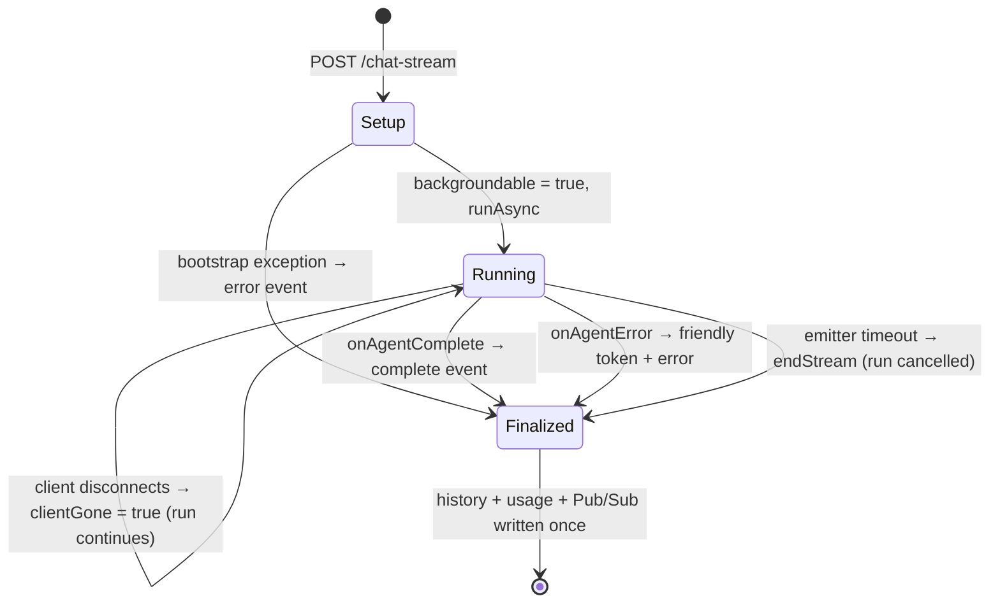

| Situation | Behaviour |
|---|---|
| **User closes the tab during the run** | `onEmitterEnded` sees `backgroundable && !finalized` and only sets `clientGone = true`. Later writes to the dead emitter are ignored. The run finishes and finalises normally, and the answer is in history when the user returns (or they can reconnect). |
| **User leaves during setup** | `backgroundable` is still false, so the turn is finalised immediately and the race guard stops the run from starting. |
| **15-minute timeout** | `endStream` disposes the subscription (cancelling the run), finalises, and completes the emitter. A timeout may mean the run is stuck, with no guarantee its completion would fire. |
| **Exception before the run** | `error` event, `completeWithError`, and the turn is marked non-backgroundable. |
| **ADK subscription error** | `onAgentError` sends a friendly `token` message, `error`, `completeWithError`, then finalises. |

---

# Part 4: Continue, reconnect & history

## 4.1 `GET /api/agent/chat-stream/continue`

Used for follow-ups the UI sends as a GET, such as quick replies and approval replies ("yes, create it").

It goes through the same pipeline as Part 3: interceptor, validation, RBAC capture, rate limit, quota, `beginTurn`, purchase-preview replay, prompt building, router, coordinator run and stream handler. The differences:

| Aspect | `/chat-stream` | `/chat-stream/continue` |
|---|---|---|
| Method | POST (multipart) | GET |
| File upload | Yes | No (an empty upload context is passed to the router) |
| Missing sessionId | New UUID | **Latest `user_session` for the user**, or a new one |
| Title generation | For new chats | No |
| Model override | `model` param | Not supported (default coordinator models) |
| Purchase preview replay | Existing sessions | Always attempted |

## 4.2 `GET /api/agent/chat-stream/{sessionId}/reconnect`

For when a user navigates away and comes back while the answer is still being written.

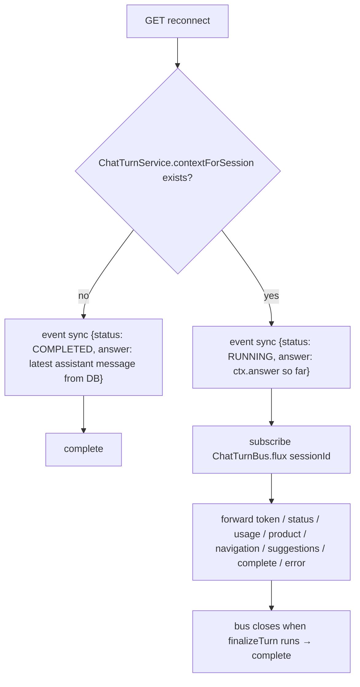

Details:

- The **first event is always `sync`**, so the UI can show the partial or final answer right away.
- **Running turn:** after `sync`, events are forwarded **live** from the bus, with the same names as the original stream.
- **Finished or unknown session:** the answer is rebuilt from `chat_message` (`latestAssistantAnswer`) and the stream closes.
- The **reconnect subscription is independent** of the run. When the reconnect client leaves or times out, only `busSubscription.dispose()` runs, and the ADK run is unaffected.
- Headers `X-Accel-Buffering: no` and `Cache-Control: no-cache` stop proxies from buffering.

## 4.3 History endpoints

| Endpoint | Returns |
|---|---|
| `GET /api/agent/history?userId&orgId&locationId[&sessionId]` | Messages for the session, or the user's latest session. 400 if the user has none. |
| `GET /api/agent/chat/sessions` | The user's chat sessions for an org/location, newest first, paged (max 100 per page) |
| `GET /api/agent/chat/sessions/{sessionId}/messages` | Full transcript ordered by `seq`. An unknown session returns an empty list, not 404. |

---

# Part 5: Files, URLs & datasets

## 5.1 Router decision tree

`FileUploadRouter.route` checks these cases **in this order**. The first match handles the turn:

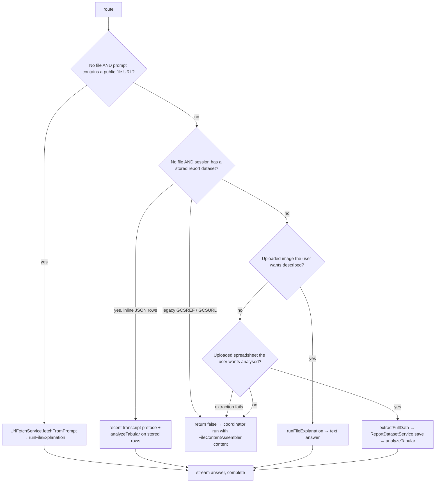

## 5.2 Case 1: URL in the prompt

*"Explain this https://example.com/sales.pdf"*

1. `UrlFetchService.fetchFromPrompt(prompt)` finds a URL, downloads it, and works out the MIME type.
2. `FileAnalysisService.buildExplanationContent(bytes, mime, boundPrompt)` builds a multimodal `Content` with the file and prompt.
3. `runFileExplanation` makes a **single model call**, not the coordinator. The answer streams through the `AnalysisPort`.
4. Errors are sent to the port as `error` and `completeWithError`.

## 5.3 Case 2: Stored dataset follow-up

The user uploaded `sales.xlsx` earlier in this chat and now asks *"group that by category"* without uploading again.

1. `ReportDatasetService.find(sessionId)` returns the saved rows.
2. If the stored data starts with `GCSREF:` or `GCSURL:`, it's a legacy GCS-backed dataset. The Python sandbox that read those was removed, so the case is **skipped** and the turn falls through.
3. Otherwise `turnLifecycle.recentTranscriptPreface(sessionId)` builds a `[RECENT CONVERSATION]` block from the last ~6 messages (each capped at 1500 characters). The analysis path is stateless, so it needs this context.
4. `analyzeTabular(port, userId, storedJson, null, mime, preface + boundPrompt)`.

## 5.4 Case 3: Image description

For an uploaded image where `intent.imageNeedingDescription()` is true, including requests like "make a chart from this screenshot":

- The image is described in text with `runFileExplanation`.
- Without this case, the coordinator might send the uploaded image to the **image generator**, which gives a worse result than a text description.

## 5.5 Case 4: Spreadsheet analysis

For an uploaded CSV/XLSX where `intent.spreadsheetNeedingAnalysis()` is true:

1. `FilePreprocessorService.extractFullData(bytes, mime)` uses Apache POI or a CSV parser to produce `List<Map<String,Object>>`.
2. The rows are serialised to JSON and **saved** with `ReportDatasetService.save(sessionId, json, mime, name, rowCount)`, so case 2 works on later turns.
3. `analyzeTabular(...)` embeds up to **`agent.embed-max-chars` = 80,000 characters** of row JSON in one code-execution-capable model turn:
   - The limit is based on measurements: about 90 KB took about 3 minutes end-to-end, and 300 KB never finished. It's a **latency** limit, not a token limit.
   - Larger datasets are reduced to a **sample of whole rows** that fits (`OversizedDatasetSamplingTest`).
4. If extraction or analysis throws, the router **deliberately falls through** to the coordinator.

## 5.6 No case matched: the coordinator handles the file

`FileContentAssembler.assemble(upload, prompt, boundPrompt, org, loc, user, ctx)` attaches the file bytes as inline parts, with a note from `UploadedFileNote` or `UploadedPhotoNote`. This is how:

- **invoices** (PDF or photo) reach `purchase_ai_agent`, which caches the bytes in `UploadedFileCache` for `InvoiceExtractionTool`
- **product photos or barcodes** reach `product_agent`

## 5.7 Large uploads

1. The client calls `POST /api/agent/chat-stream/upload-url?filename=…&contentType=…`.
2. `FileIngestionService.mintUploadUrl` returns a **signed GCS upload URL**.
3. The client uploads directly to GCS, then calls `/chat-stream` with `gcsObjectRef` and `gcsFileMime`.

> Currently `gcsObjectRef` is **accepted but not analysed**. The large-file path depended on the removed Python sandbox. See `docs/large-file-analysis-setup.md` for the history.

Multipart limits: `MULTIPART_MAX_FILE_SIZE` (25 MB) and `MULTIPART_MAX_REQUEST_SIZE` (30 MB). Exceeding them returns **413**.

---

# Part 6: The specialist agents

## 6.1 Routing overview

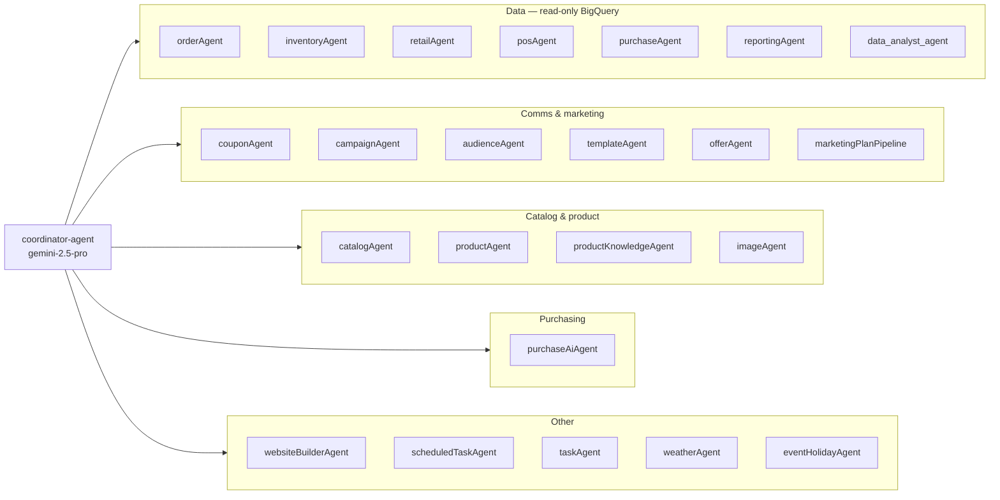

Routing is by **intent**:
- A single-domain question goes to that domain's specialist.
- A cross-domain or whole-business question goes to `data_analyst_agent`, unless the kill switch is off.
- Exports (Excel, chart, report) always go to the analyst.

## 6.2 Data agents (read-only BigQuery)

| Agent | Domain | Default model | Override env |
|---|---|---|---|
| `orderAgent` | Orders, sales, item velocity, payments, returns | gemini-2.5-flash | `ORDER_AGENT_MODEL` |
| `inventoryAgent` | Stock, expiry, negative inventory, trends | gemini-2.5-flash | `INVENTORY_AGENT_MODEL` |
| `purchaseAgent` | PO/GRN status, RTV, debit notes, payables, vendor KYC, STN status (**read-only**) | gemini-2.5-flash | `PURCHASE_AGENT_MODEL` |
| `retailAgent` | Retail operations | gemini-2.5-flash | `RETAIL_AGENT_MODEL` |
| `posAgent` | POS tills, sessions, terminals, cash drawers, POS metrics | gemini-2.5-pro | `POS_AGENT_MODEL` |
| `reportingAgent` | Named business reports and ad-hoc reports | — | — |
| `data_analyst_agent` | Cross-domain analysis, exports | gemini-2.5-pro | `DATA_ANALYST_AGENT_MODEL` |

Shared properties:
- All reads go through `BigQueryTool`: SELECT/WITH only, dry-run scan limit, job timeout.
- **None of them has a write tool.**

### posAgent

- Reads the **`pos` BigQuery dataset**, a **Datastream replica** of the POS database, with tables like `pos.user_session`, `pos.license_detail` and `pos.order_metrics`.
- **Never** calls the POS service's REST API, so it needs no service configuration.
- Uses pro because it writes SQL across multiple tables.
- Important: in `pos.user_session`, **`status = 'ACTIVE'`** is what identifies an active session. The `active = TRUE` column matches every row.
- Local testing: `run-local-posagent.sh` (port 8093, RBAC off, 10 GB scan limit, 120s timeout) and `test-pos-agent.sh`.

### reportingAgent: two paths

```
User question → reportingAgent classifies intent
   ├── Known OMS ReportType (DSR_REPORT, DAY_CLOSING_REPORT_LITE, …)
   │     → ReportingTool.generateReport → POST {oms}/reports/generate
   │         (idempotent: OMS returns an existing GENERATED report unless regenerate=true)
   │     ├── COMPLETED → return docUrl / signedUrl
   │     └── PROCESSING → poll GET {oms}/reports/{docId}/status (bounded) → COMPLETED / FAILED / timeout
   └── Ad-hoc analytical report
         → ReportingService SQL/BigQuery report-job engine
```

### data_analyst_agent

- Handles whole-business questions ("how is my business doing vs last month across sales, stock and purchases?").
- Uses **`AnalystThinking`** and **`AnalystBriefing`** prompt modules for structured reasoning and executive-style answers.
- Uses **`ReportExportRules`** and `runReportQuery` for exports to GCS with signed links.

## 6.3 Comms & marketing

| Agent | What it does | Backend |
|---|---|---|
| `couponAgent` | Create and manage coupons (`CouponAgentInstructions`) | Coupon service via `CouponTool` |
| `campaignAgent` | Campaigns (WhatsApp/SMS/email) | Comms service via `CampaignTool` |
| `audienceAgent` | Customer segments | Comms/segment APIs via `AudienceTool` |
| `template-agent` | Message templates by channel | Comms via `TemplateTool` |
| `offerAgent` | Offers | `OfferTool` |
| `marketingPlanPipeline` / `marketingAgent` | Multi-step plan: gather data → plan → execute (`DataGatheringPipeline`, `MarketingPlanPipeline`, `ExecutionPipeline`) | Sequential/Parallel agents with `AgentTool` wrapping |

`GuardrailsTool` checks content and actions for policy issues in marketing flows.

## 6.4 Catalog & product

### catalog_agent (read-only)

- Searches and browses the catalog through the **CMS Elasticsearch filter API** (`CatalogTool`).
- Validates filter enum values before calling (`CatalogToolFilterValidationTest`).
- Compacts listing results so they fit in the model's context.
- Routing rule 14: search, list, browse, detail.

### product_agent (create/update)

Routing rule 14a covers: create, add, generate or update a product, **including a photo of a physical product** (treated as product creation, not image generation).

Flow:
1. **Draft.** The model writes the product fields itself. There's no external generate-and-poll step.
2. **Research.** It can research the product on the web (Tavily) through `ProductTool`.
3. **Images.** `ImageGenerationTool` uses the Vertex **Gemini image model** (`VERTEX_IMAGE_MODEL_URL`).
4. **Preview.** A `product` preview card is sent to the chat, built from the tool arguments.
5. **Save.** The draft is saved to CMS as a **DRAFT** **only when the user explicitly says to save**.
6. **Approval** is **human-only** and happens outside this service. `AgentType.PRODUCT.allowsTool` blocks `product.approve` in the older stack too.

Source-aware payloads: `sourceType` and the industry (grocery, restaurant, …) change which fields and payload shape are used. See `docs/superpowers/specs/*product*`.

Tap-to-preview: `GET /api/agent/product/{id}/{locationId}` is a **deterministic** CMS passthrough with no LLM involved (`ProductViewController`).

### productKnowledgeAgent

Answers "how does Pallet work" questions (concepts, integration guides, troubleshooting, FAQs, workflows) using CMS knowledge chunks, top `PRODUCT_KNOWLEDGE_TOP_K` (5), through `ProductKnowledgeTool`.

## 6.5 Purchasing: `purchase_ai_agent`

A **single agent** with about 12–13 numbered **flows** in its prompt (`PurchaseAiAgentInstructions`, COORDINATOR variant). Every capability also works on its own, for example matching products from a bare list with no invoice.

### Invoice → GRN journey

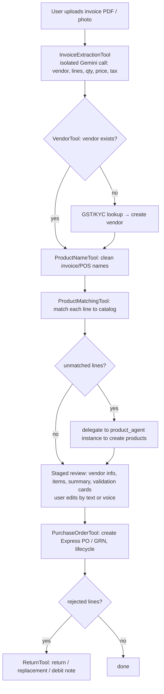

Step by step:

1. **Extract.** `InvoiceExtractionTool` makes a **separate, isolated Gemini call** (client from `GeminiClientResolver`) that reads the invoice into structured data. Bytes uploaded in the same turn come from `UploadedFileCache`. A `purchase invoice preview` card is sent.
2. **Resolve the vendor.** `VendorTool` looks up, validates (GST sandbox/KYC under `/kyc/*` on the vendor service), creates or updates the vendor.
3. **Clean names.** `ProductNameTool` (another isolated Gemini call) turns abbreviated invoice or POS text like "AMUL TZD MLK 500ML" into proper product names.
4. **Match.** `ProductMatchingTool` matches each line against the catalog and sends `purchase product match` cards.
5. **Create missing products** by delegating to a **dedicated `product_agent` instance**, so purchasing never duplicates the product field rules, image pipeline or research.
6. **Staged review.** The UI shows vendor info, items, summary and validation status (from completion trailers). The user can correct anything by text or voice. Previews are cached (`PurchasePreviewCacheService`), which is why **preview replay** (§3.9) exists.
7. **Create the GRN.** `PurchaseOrderTool` creates the Express Purchase Order and manages its lifecycle, sending `purchase GRN status` cards.
8. **Returns.** `ReturnTool` handles rejected lines: return to vendor, replacement, or debit note settlement.

Related tools:
- `PurchaseIndentTool`: converts a purchase indent to a PO
- `StockTransferTool`: stock transfer notes (create → approve → ship → receive)

Routing boundary:
- **Rule 16** sends **read-only** purchase questions to `purchaseAgent` (BigQuery). A PO number, "return" or "transfer" in the message doesn't by itself mean rule 16.
- **Rule 16a** sends anything that **creates or changes** data to `purchase_ai_agent`.

## 6.6 Other agents

| Agent | Purpose | Tools |
|---|---|---|
| `websiteBuilderAgent` | Edit CMS website pages and content (patch-based) | `WebsiteBuilderTool` |
| `scheduledTaskAgent` | Create and manage scheduled tasks from chat | `ScheduledTaskTool` |
| `taskAgent` | Task handling | — |
| `weatherAgent` | Local weather for planning | `WeatherTool`, `GeocodingTool` (Google Maps) |
| `eventHolidayAgent` | Upcoming festivals and holidays | `EventHolidayTool` |
| `imageAgent` | Generate marketing images | `ImageGenerationTool` |

`TimeTool` gives agents the current date and time, so "last week" is calculated correctly.

---

# Part 7: The older single-agent flow (`/run`, `.../stream`)

## 7.1 Synchronous: `POST /api/agent/run`

The same path serves `/copy/enhance` and the synchronous audience, proposal, budget and SEO endpoints.

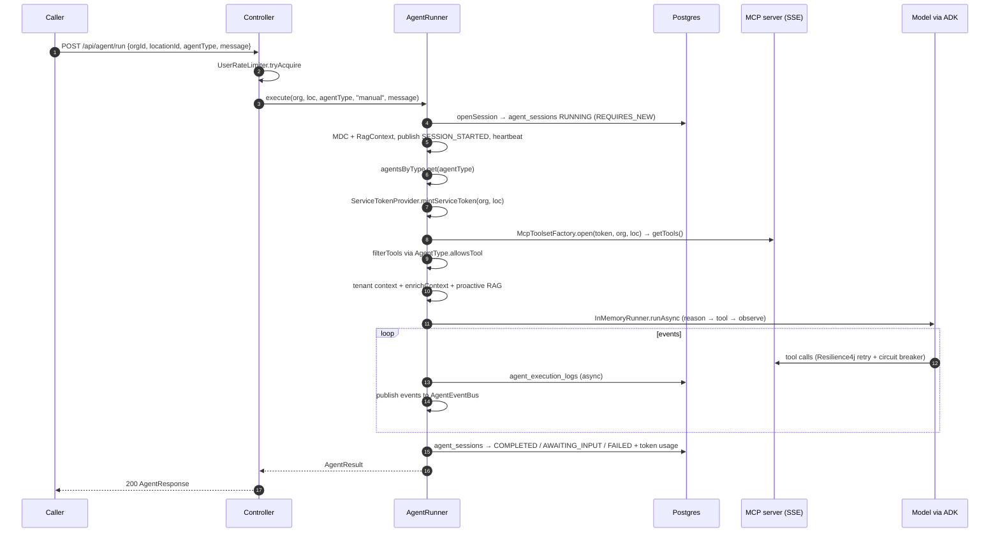

`AgentRunner.runFromSession` logs its steps as "STEP n/10":

1. **Open the session.** An `agent_sessions` row is inserted with `status=RUNNING` in a **`REQUIRES_NEW` transaction**, so it's saved even if the run fails.
2. **Logging context.** MDC gets `sessionId`, `restaurantId`, `locationId` and `agentType`, so every log line shows `[sid=… rest=… loc=… agent=…]`.
3. **RAG scope.** `RagContext.set(restaurantId, locationId, userId)` in a ThreadLocal, so `RagMemoryTool` can scope retrieval **without exposing IDs as model-visible parameters**.
4. **Start.** Publishes `SESSION_STARTED` to `AgentEventBus` and starts `AgentHeartbeat`, since the first model response often takes 15–30 seconds before any tool runs.
5. **Resolve the agent.** `agentsByType.get(agentType)`. If there's none, it fails with "No agent registered".
6. **Mint a service JWT** for this tenant with `ServiceTokenProvider`.
7. **Open the MCP toolset.** A per-tenant SSE connection to pallet-mcp (`McpToolsetFactory.open`) downloads the tool catalog. Connect timeout is 5s, request timeout `MCP_REQUEST_TIMEOUT_MS` is 120s, which is above the product-generation 90s poll limit.
8. **Filter tools** with `AgentType.allowsTool`:
   - by **namespace**, for example `CAMPAIGN` gets `campaign`, `audience`, `template` and `guardrail`
   - with **special cases**:
     - `BUDGET` also gets `campaign.list_active` and `campaign.get_analytics`
     - `PROPOSAL` gets a hand-picked read-only list covering campaign, budget, template, inventory signals, today's orders and item velocity, BigQuery data tools and customer analytics
     - `INVENTORY_INSIGHT`, `CUSTOMER_INSIGHT` and `LOYALTY_INSIGHT` are limited to **read-only** tools
     - `PRODUCT` never gets `product.approve`
9. **Build the context.**
   - Tenant constraints: *"org_id=…, location_id=… — pass these to every tool call; scope all reads to this single location."*
   - If the message is JSON, `business_name` and `location_city` are added.
   - `enrichContext(agentType, message)` adds agent-specific context.
   - **Proactive RAG:** the top 5 memories for the message are fetched and put before it. The hits are saved in `session.metadata.ragHits` for auditing.
10. **Run.** `rebuildWithTools` attaches the filtered tools and callbacks, then an `InMemoryRunner` drives the loop:
    - MCP calls use Resilience4j (Part 14).
    - `processEvent` writes each step asynchronously to **`agent_execution_logs`** with a tool response summary (`summarizeToolResponse`, including a proposal summary for proposal tools).
    - Events are published to `AgentEventBus`.
11. **Finish.**
    - **COMPLETED:** normal answer.
    - **AWAITING_INPUT:** the agent started its reply with **`[AWAITING_INPUT]`**, meaning it needs a human answer. `continueSession(parent, child, reply)` resumes it later, with the history rebuilt recursively through parent sessions.
    - **FAILED:** an error, or MCP unavailable (`mcpUnavailable*` returns a clear message).
    - Token usage is saved and `AgentResult` is returned.

These endpoints usually return **HTTP 200 with `status: FAILED`**, not an HTTP error.

## 7.2 Asynchronous: `.../stream` and `/trigger/...`

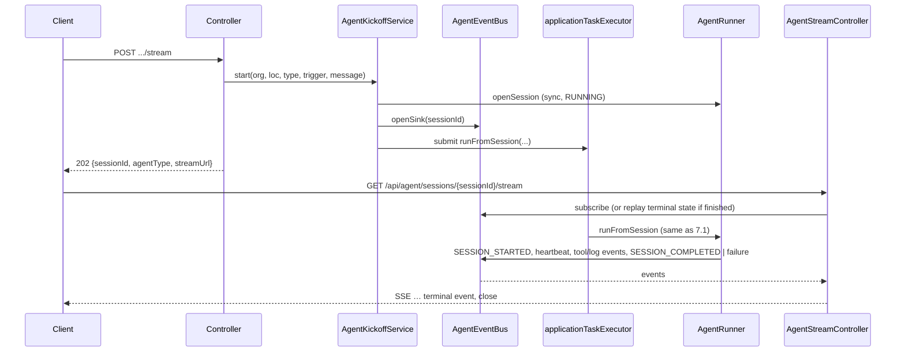

`AgentKickoffService.start`:
1. **Opens the session synchronously**, so the ID exists before the response is returned.
2. Opens the `AgentEventBus` sink for that session.
3. Submits `runFromSession` to the shared `applicationTaskExecutor`.
4. Returns `AgentRunAcceptedResponse`.

The client then opens `GET /api/agent/sessions/{id}/stream`:
- **Running:** subscribes to the bus and forwards events live.
- **Already finished:** sends the final state and closes.

Failures inside the background run **can't** change the 202 response. They're written to the `agent_sessions` row and sent as stream events.

Polling alternatives:
- `GET /api/agent/sessions/{id}/status`
- `GET /api/agent/sessions/{id}/logs`
- `GET /api/agent/sessions/{id}/audience-result`
- `GET /api/agent/sessions/latest/{orgId}[/{locationId}]`

## 7.3 Domain endpoints on this stack

| Endpoint | Agent | Notes |
|---|---|---|
| `POST /audience/generate/{orgId}[/{locationId}]` | AUDIENCE_GENERATOR | Sync |
| `POST /audience/generate/{orgId}[/{locationId}]/stream` | AUDIENCE_GENERATOR | Async |
| `POST /proposals/generate/{restaurantId}[/{locationId}]` | PROPOSAL | Fixed prompt: "Review SEO, campaigns, audience, budget. Create 3–5 high-confidence proposals with evidence." |
| `POST /proposals/generate/…/stream` | PROPOSAL | Async |
| `POST /budget/optimize/{restaurantId}[/{locationId}]` | BUDGET | Sync |
| `POST /seo/audit/{restaurantId}[/{locationId}]` | SEO | Sync |
| `POST /seo/keywords/generate/{orgId}/{locationId}/stream` | SEO_KEYWORD_GENERATOR | Async |
| `POST /seo/faqs/generate/{orgId}/{locationId}/stream` | SEO_FAQ_GENERATOR | Async |
| `POST /seo/competitor-audit/stream` | COMPETITOR_AUDITOR | Async |
| `POST /seo/website-audit/{auditId}/analyze/stream` | WEBSITE_SEO_AUDITOR | Async |
| `POST /seo/website-audit/trigger` | — | Internal cross-service trigger |
| `POST /copy/enhance` | COPY_ENHANCER | No tools. Rewrites marketing copy. |
| `POST /trigger/{agentType}/{orgId}/{locationId}` | Any | Generic async kickoff. An unknown type returns 400. |

The **AI search auditor** uses `providers/` (`GeminiSearchProvider`, `ClaudeSearchProvider`, `OpenAiSearchProvider`, `PerplexitySearchProvider`) to simulate how AI search engines describe a business. This is its only use of those providers.

---

# Part 8: Scheduled tasks

## 8.1 Data model

| Field | Meaning |
|---|---|
| `id` | Prefixed ID such as `TASK-000123` (`PrefixedSequenceIdGenerator`) |
| `orgId`, `locationId`, `userId` | Owner and tenant |
| `instructionText` | What to do, in plain language, e.g. "Send me a summary of last week's sales" |
| schedule | Cron for recurring tasks, or a one-off time |
| `nextRunAt`, `lastRunAt` | Scheduling state |
| `status` | `ACTIVE`, paused, cancelled, completed |
| `autonomyMode` | `AUTONOMOUS`, `APPROVAL_REQUIRED` or `CONDITIONAL` |
| `approvalConfig` | e.g. `{thresholdDescription: "PO total above ₹50,000"}` |
| `maxDurationMinutes` | Per-task timeout (default `SCHEDULED_TASK_DEFAULT_MAX_DURATION_MINUTES` = 30) |
| `handlerRef` | Optional typed Java handler instead of the LLM |

Each execution creates a **`scheduled_task_run`** with a status (`PENDING`, `IN_PROGRESS`, `AWAITING_APPROVAL`, `COMPLETED`, `FAILED`, `TIMEOUT`, `MISSED`, rejected), `scheduledFor`, `startedAt`, `endedAt`, `agentSessionId`, output text, total tokens and error message.

## 8.2 Creating tasks

1. **REST:** `POST /api/agent/scheduled-tasks`
2. **Template:** `scheduled_task_template` (org-scoped CRUD at `/api/agent/scheduled-tasks/templates`, with `PATCH /{id}` and `POST /{id}/archive`)
3. **Chat:** *"every Monday at 9am send me a sales summary"* → coordinator → `scheduledTaskAgent` → `ScheduledTaskTool`. See `docs/scheduled-task-external-creation-plan.md`.

Management endpoints:

| Endpoint | Action |
|---|---|
| `GET /scheduled-tasks`, `GET /{id}` | List, get |
| `GET /{id}/runs`, `GET /{id}/runs/{runId}/output` | Run history, full output |
| `POST /{id}/trial-run` | Run once now to preview output. Doesn't advance the schedule (`ScheduledTaskTrialRunService`, `completer.saveTrialRun`). |
| `POST /{id}/pause`, `/resume`, `/cancel` | Lifecycle changes |
| `POST /{id}/runs/{runId}/approve`, `/reject` | Approval (§8.6) |

## 8.3 The dispatcher

`ScheduledTaskDispatcherJob`, run by Quartz every `SCHEDULED_TASK_POLL_INTERVAL_SECONDS` (60).

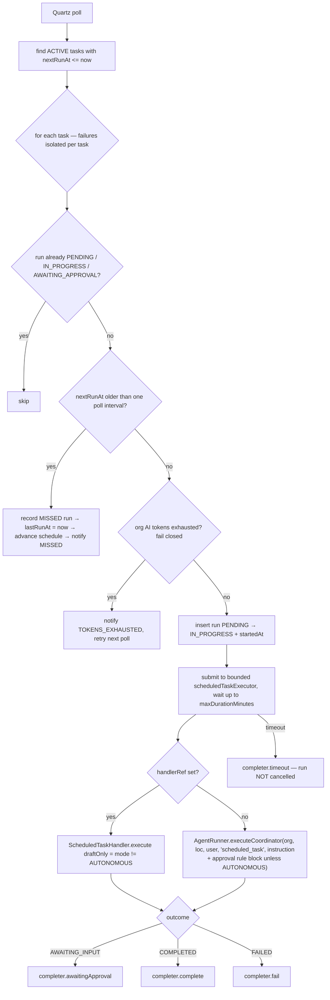

Each rule explained:

1. **Query.** `findByStatusAndNextRunAtLessThanEqual(ACTIVE, now)`.
2. **Per-task isolation.** Each dispatch has its own try/catch, so one task can't block the rest.
3. **No overlap.** If a run is `PENDING`, `IN_PROGRESS` or `AWAITING_APPROVAL`, the task is skipped. A task waiting on an unapproved draft **isn't dispatched again or marked missed**.
4. **Missed occurrences.** If `nextRunAt` is more than one poll interval in the past (for example, the service was down):
   - A `MISSED` run is recorded with the message "was scheduled for X but the dispatcher didn't poll again until …".
   - `lastRunAt = now`, so the UI shows that something happened.
   - `advanceOrComplete` moves to the next occurrence, or completes a one-off task.
   - A `MISSED` notification is sent.
   - Old runs are **not** caught up, so the service never fires a burst of stale runs after an outage.
5. **Token check (fails closed).** `AiUsageClient` checks the org's remaining tokens. **No plan on file or an unreachable usage service is treated as exhausted.** The service won't spend tokens it can't confirm. It sends `TOKENS_EXHAUSTED` and retries next poll.
6. **Create the run.** `PENDING`, then `IN_PROGRESS` with `startedAt`.
7. **Bounded execution.** Submitted to `scheduledTaskExecutor`, and `future.get(maxMinutes)` waits.

## 8.4 What a run executes

### Typed handler (`handlerRef` set)

- `ScheduledTaskHandlerRegistry.find(ref)`. A missing handler throws `IllegalStateException`.
- `handler.execute(task, draftOnly)`, where `draftOnly = autonomyMode != AUTONOMOUS`.
- `awaitingApproval = draftOnly && result.requiresApproval`.
- **The registry currently has no handlers.** This path exists for future use.

### Coordinator (normal case)

`AgentRunner.executeCoordinator(org, loc, user, "scheduled_task", instruction [, approvalBlock])` → `executeCoordinatorInternal`:

1. `metrics.recordSessionStarted(COORDINATOR, triggerSource)`.
2. **Opens an `agent_sessions` row** of type `COORDINATOR`, with a parent session ID if this is a continuation.
3. MDC binding.
4. `SessionUsage` plus a **token-tracked, RBAC-pruned copy** of the coordinator (the same factory as chat).
5. `InMemoryRunner` with a fresh ADK session.
6. Prompt = `tenantConstraintBlock(org, loc, user)` + optional instruction block + message.
7. Runs **without streaming**, counting tool calls and keeping the **last non-thought text block** as the answer.
   - `finalResponse` can't be used here, because narration also carries it (§3.15). Narration is always followed by something else, while the real answer is followed by nothing.
8. `looksLikeUnexecutedPlan` detects answers like "I will now create the PO…" where the model only described a plan and didn't do it, and handles them.
9. Status is set to `COMPLETED`, `AWAITING_INPUT` (reply starts with `[AWAITING_INPUT]`) or `FAILED`, and tokens are saved.

`handlerSummary` **always** contains the full answer text. So a completed run's output is visible in run history even when no GCS bucket is configured.

## 8.5 Autonomy modes

| Mode | Instruction block added | Behaviour |
|---|---|---|
| `AUTONOMOUS` | None | The instruction runs as written and actions are committed. |
| `APPROVAL_REQUIRED` | *"[UNATTENDED SCHEDULED RUN — APPROVAL RULE] Nobody is watching in real time. You MUST stop short of committing any side-effecting action (creating, updating, submitting or approving a PO, product, campaign, coupon, refund…). Prepare it as a DRAFT / PENDING-APPROVAL using the domain's draft-capable operation. Do NOT call any tool that finalizes, submits or approves it."* | Always stops at a draft |
| `CONDITIONAL` | *"Only stop short of committing if this rule is met: '<thresholdDescription>'. If met → draft only. If NOT met → proceed and commit normally."* | Draft only when the rule applies |

For both draft modes: *"If, and only if, you are stopping short, start your FINAL response with exactly `[AWAITING_INPUT]` followed by a clear summary of what you propose and why, so a human can reply 'approve' or explain what to change."*

`MarketingAgent`'s interactive mode uses the same `[AWAITING_INPUT]` marker.

## 8.6 Outcomes: `ScheduledTaskRunCompleter`

| Method | Effect |
|---|---|
| `complete(task, run, sessionId, summary, output, tokens)` | Run → COMPLETED. Output and tokens saved, output uploaded to GCS if configured, `lastRunAt` set, `advanceOrComplete`, notification sent. |
| `awaitingApproval(...)` | Run → **AWAITING_APPROVAL** with the draft `agentSessionId` and proposal text, notification sent |
| `fail(task, run, message)` | Run → FAILED with the root cause message |
| `timeout(task, run, maxMinutes)` | Run → TIMEOUT. **The agent run can't be cancelled** (AgentRunner has no cancellation hook) and may keep going, possibly still committing side effects. |
| `reject(task, run, reason)` | Run resolved **without committing**. The schedule still advances. Not a failure. |
| `advanceOrComplete(task, from)` | Recurring task: next cron occurrence. One-off: task marked completed. |

`ScheduledTaskNotifier` sends `ScheduledTaskNotificationEvent`s: MISSED, TOKENS_EXHAUSTED, completion, approval needed, failure.

## 8.7 Approval & rejection

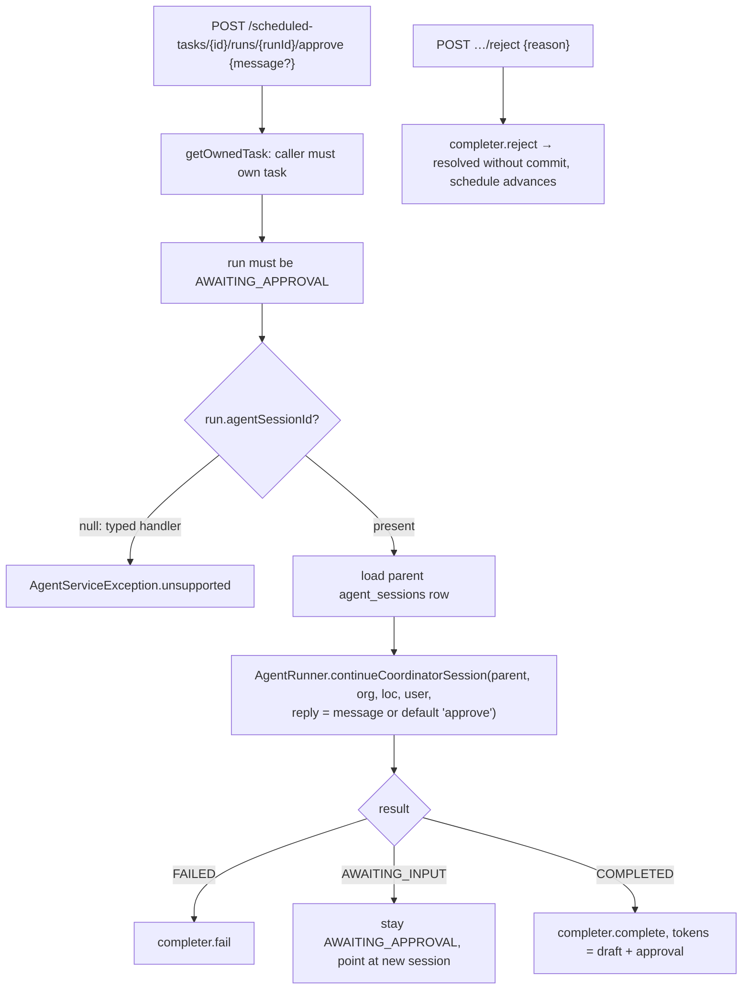

**Approve** (`ScheduledTaskApprovalService.approve`):
1. Ownership check: `taskService.getOwnedTask(taskId, userId)`.
2. The run must be in `AWAITING_APPROVAL`.
3. Typed-handler runs have no session to continue, so they're rejected as **unsupported**.
4. `continueCoordinatorSession` continues the **same conversation** as a child session (with `parentSessionId`). The reply is the user's message, for example *"approve, but change the quantity to 50"*, or a default approval. The agent now commits.
5. Result:
   - `COMPLETED`: the run is completed, and `totalTokens` = draft tokens + approval tokens.
   - `AWAITING_INPUT` again: the run stays in approval, pointing at the new session. This happens if the agent has another question or a conditional rule applied again.
   - `FAILED`: the run is marked failed.

**Reject:** resolves the run with the reason. Nothing is committed and the schedule moves on.

---

# Part 9: Autopilot jobs

Quartz cron jobs declared in `AutopilotScheduler`. Each iterates over **autopilot-enabled restaurants** and runs the matching single agent through the Part 7 flow.

| Job | Cron | Meaning | Agent |
|---|---|---|---|
| `ProposalGenerationJob` | `0 0 0/2 * * ?` | Every 2 hours | `PROPOSAL`: reviews SEO, campaigns, audience and budget, and creates 3–5 proposals for the action queue |
| `SeoAuditJob` | `0 0 6 * * ?` | Daily at 06:00 | `SEO` audit |
| `BudgetOptimizationJob` | `0 0 9 ? * MON` | Mondays at 09:00 | `BUDGET` reallocation |

> Quartz uses an **in-memory job store** (`job-store-type: memory`) with no cluster coordination. With N instances, **every job runs N times**. Plan for this before scaling out.

---

# Part 10: Voice

## 10.1 Flow

```mermaid
sequenceDiagram
    participant B as Browser
    participant HS as VoiceHandshakeInterceptor
    participant WS as VoiceWebSocketHandler
    participant OA as OpenAI Realtime
    participant VB as VoiceAgentBridge
    participant AR as AgentRunner (coordinator)
    B->>HS: connect /ws/voice?sessionId&voice&realtimeModel (+ auth)
    HS->>HS: resolve user, org, loc, roles; allowlist voice/model
    HS->>WS: afterConnectionEstablished → VoiceSessionState
    WS->>OA: open realtime session, tools = [ask_pallet_agent]
    B->>WS: binary audio frames
    WS->>OA: forward audio
    OA->>WS: function_call ask_pallet_agent {question}
    WS->>VB: ask(state, question)
    VB->>VB: RBAC from handshake roles
    VB->>VB: chat_session + user chat_message, transcript preface
    VB->>AR: executeCoordinator(org, loc, user, "voice", prompt, rbacContext, allowedAgents)
    AR-->>VB: AgentResult
    VB->>VB: record assistant chat_message (raw answer)
    VB-->>WS: VoiceAnswer (spoken + display)
    WS->>OA: function_call_output = spoken
    OA-->>WS: synthesized audio
    WS-->>B: audio + on-screen text
    B->>WS: text {type: barge_in | end_session}
```

## 10.2 Step by step

1. **Handshake.** `VoiceHandshakeInterceptor` works out user, org, location and **roles once at connection time**. The `voice` and `realtimeModel` query parameters are only used if they're in `VOICE_ALLOWED_VOICES` / `VOICE_ALLOWED_REALTIME_MODELS`, otherwise the defaults apply (`alloy`, `gpt-realtime-2.1`). A client can't choose a model the service didn't approve. If an `agentType` is named explicitly, it's checked here.
2. **Realtime session.** `OpenAiRealtimeClient` connects to OpenAI with **one tool**, `ask_pallet_agent(question)`: *"Answer any question about this store's orders, sales, inventory, purchases, customers, campaigns, coupons or reports."*
3. **Audio.** Microphone audio arrives as binary WebSocket frames and is forwarded. OpenAI handles speech-to-text, turn-taking and speech synthesis.
4. **Tool call.** For a business question, OpenAI calls `ask_pallet_agent`.
5. **`VoiceAgentBridge.ask(state, question)`:**
   - `permissionService.hasAnyAgentAccess(roles)`. If false, it replies "Sorry, you don't have permission to use the assistant."
   - `buildAllowedAgentsContext(roles)` and `getAllowedCoordinatorAgentNames(roles)`. Both the prompt block and sub-agent removal are applied, as in chat. The prompt block alone would only be advisory.
   - Opens `chat_session` and records the user turn in the **same chat session** as typed chat, so speaking and typing form one conversation.
   - `transcriptPreface(sessionId) + question` for context.
   - `runner.executeCoordinator(..., "voice", prompt, rbacContext, allowedAgents)`: full routing, BigQuery, tokens and logs.
   - On failure or a null response: "Sorry, I ran into a problem getting that. Please try again."
   - Saves the **raw** answer to history.
   - Returns `VoiceAnswer.of(response)`, which splits it into a **spoken** form (short, no tables or markdown) and a **display** form (full).
6. OpenAI reads the spoken form aloud, and the UI shows the display form.
7. **Control messages:** `barge_in` (the user interrupts, so playback stops) and `end_session`.

## 10.3 Why a single tool

An earlier version used reflection to expose about **30 tools** directly to OpenAI. Each was a second, unaudited path to the data: **no RBAC, no routing, no token accounting, no history**. Sending everything through `ask_pallet_agent` → `AgentRunner` gives voice all of those checks. The extra routing step costs a few seconds, which is small next to BigQuery queries that already take tens of seconds.

Voice can be turned off with `VOICE_ENABLED=false`. The test page is `voice-test.html`.

---

# Part 11: RBAC in depth

## 11.1 Flow

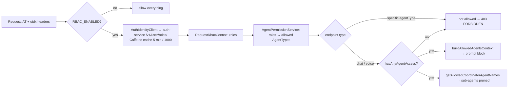

## 11.2 Role → agent mapping (`pallet.agent.rbac.roles`)

| Role group | Roles | Allowed agents |
|---|---|---|
| Super admins | `PALLET_ADMIN`, `HO_ADMIN`, `ORGANISATION_ADMIN` | `*` (all) |
| Campaign / marketing | `CAMPAIGN_*`, `MARKETING_*` | admin/creator: CAMPAIGN, AUDIENCE_GENERATOR, COPY_ENHANCER; viewer: CAMPAIGN |
| Inventory | `INVENTORY_*` | INVENTORY_INSIGHT, DATA_ANALYST |
| Customer / loyalty | `CUSTOMER_*`, `LOYALTY_*` | CUSTOMER_INSIGHT (+ AUDIENCE_GENERATOR for admin/creator), LOYALTY_INSIGHT |
| Coupon / offer | `COUPON_*`, `OFFER_*` | COUPON (+ CAMPAIGN for offer admin/creator) |
| Product | `PRODUCT_*` | admin/creator: PRODUCT, CATALOG; viewer: PRODUCT |
| Content / website | `CONTENT_*`, `B2C_CONTENT_*`, `B2B_CONTENT_*`, `LAYOUT_*` | WEBSITE_BUILDER (+ COPY_ENHANCER for admin/creator) |
| Purchase | `PURCHASE_*`, `PURCHASE_BILLING_*`, `PURCHASE_INWARD_*`, `PO_*`, `PI_*` | admin/creator: PURCHASE_AI, DATA_ANALYST; viewer: DATA_ANALYST |
| Orders | `ORDER_*`, `ORDER_PAYMENT_*`, `ORDER_RETURN_*` | ORDER_ANALYTICS, DATA_ANALYST |
| Sales channel / marketplace | `SALES_CHANNEL_*`, `MARKET_PLACE_*` | admin: CATALOG, PRODUCT, DATA_ANALYST; creator: CATALOG, PRODUCT; viewer: DATA_ANALYST |
| Reports | `REPORT_*` | DATA_ANALYST, ORDER_ANALYTICS |
| HO | `HO_USER`, `HO_MANAGER` | CAMPAIGN, INVENTORY_INSIGHT, CUSTOMER_INSIGHT, ORDER_ANALYTICS, DATA_ANALYST (+ LOYALTY_INSIGHT for manager) |
| Location | `LOCATION_ADMIN` / `_CREATOR` / `_VIEWER` | admin: DATA_ANALYST, INVENTORY_INSIGHT, POS; creator: DATA_ANALYST; viewer: DATA_ANALYST, ORDER_ANALYTICS |
| POS | `POS_MANAGER`, `POS_CAPTAIN` | INVENTORY_INSIGHT, ORDER_ANALYTICS, POS |
| SEO / hyperlocal | `HYPERLOCAL_*` | SEO (+ WEBSITE_BUILDER for admin/creator) |
| Vendor / brand | `VENDOR_*`, `BRAND_*` | DATA_ANALYST (+ PURCHASE_AI for vendor admin, + PRODUCT for brand admin/creator) |
| **No access** | `USER`, `WAITER`, `CHEF`, `DELIVERY_AGENT`, `POS_USER`, `B2C_USER`, `B2B_CUSTOMER`, `PRINTER_AGENT_AT`, `ODS_USER` | Deliberately omitted |

## 11.3 Three enforcement levels

1. **Endpoints for a specific agent type** reject the request if that `AgentType` isn't allowed.
2. **Chat and voice** require `hasAnyAgentAccess`.
3. **Coordinator pruning.** `TokenTrackingAgentFactory` **removes** disallowed sub-agents from this request's copy of the tree. This is the real guarantee: even if the prompt block were ignored, the coordinator can't transfer to an agent that isn't there.

The prompt block also tells the model what the user is allowed to do, so it can answer "you don't have access to purchasing" instead of trying.

`ChatStreamRbacParityTest` checks that the `/chat-stream` and `/continue` paths apply RBAC the same way.

## 11.4 Service-to-service security

| Component | Role |
|---|---|
| `ServiceJwtAuthFilter` | Validates `Authorization: Bearer <jwt>` from internal callers (`AGENT_JWT_SECRET`) |
| `ServiceTokenProvider` | Mints tenant-scoped JWTs for calls to MCP, and the service account token (`AGENT_SERVICE_TOKEN`) |
| Static tool tokens | `CMS_SERVICE_TOKEN`, `PURCHASE_SERVICE_TOKEN`, `VENDOR_SERVICE_TOKEN`, `OMS_SERVICE_TOKEN`, `REPORTING_SERVICE_TOKEN`, `COUPON_AUTH_TOKEN` |
| User access token | Passed in the tenant prompt context, so tools can call user-scoped APIs |

---

# Part 12: Token accounting, cost & quota

## 12.1 Lifecycle

```mermaid
flowchart LR
    Q[Quota check<br/>AiTokenQuotaService / AiUsageClient] --> RUN[Run]
    RUN --> CAP[Capture per model call<br/>UsageTrackingGemini / UsageTrackingLlm / ClaudeLlm / OpenAiLlm]
    CAP --> SU[SessionUsage per agent+model<br/>input / output / cache-read / thinking]
    SU --> LIVE[usage SSE events]
    SU --> FIN[finalizeTurn / run end]
    FIN --> CU[ChatUsageService.persist async]
    FIN --> TU[TokenUsageService.save async → agent_token_usage]
    TU --> COST[TokenCostCalculator]
    FIN --> PS[AIBusinessService → Pub/Sub consumption event]
    TU --> REP[/api/agent/metrics/token-usage]
```

## 12.2 Details

1. **Before the run**
   - Chat: `AiTokenQuotaService.validate(org, loc)`.
   - Scheduled tasks: `AiUsageClient` check, which **fails closed**.
2. **Capture.** Every model wrapper reports usage metadata (prompt, candidates, cached, thinking tokens) to a consumer bound to `(agentName, model)`.
3. **Accumulate.** `SessionUsage` → `TokenUsageAccumulator` per agent and model, with a running total. In chat, the callback sends **`usage`** SSE events as the totals change.
4. **Price.** `TokenCostCalculator` uses `pallet.agent.pricing.models` (USD per million tokens):

   | Model | Input | Output | Cache read | Thinking |
   |---|---|---|---|---|
   | gemini-2.5-pro | 1.25 | 10.00 | 0.31 | 3.50 |
   | gemini-2.5-flash | 0.30 | 2.50 | 0.075 | 2.50 |
   | claude-sonnet-4-20250514 | 3.00 | 15.00 | 0.30 | 15.00 |
   | gpt-4o | 2.50 | 10.00 | 1.25 | 0.00 |

   A model **not in the table** is priced with `Pricing.DEFAULT`, which is **Gemini 2.5 Pro**.
5. **Save** (async, off the hot path): `ChatUsageService.persist` for chat, and `TokenUsageService.save` → `agent_token_usage`.
6. **Publish.** `AIBusinessService.triggerConsumptionEvent` → `AIEventPublisher` → Pub/Sub topic `PUBSUB_TOPIC_ID`. Downstream billing and quota systems deduct from the org's plan.
7. **Report.**
   - `GET /api/agent/metrics/token-usage?from&to` returns totals grouped by date, agentType and model.
   - `/by-user` covers rows with a user ID.
   - `/by-agent` groups by agent.
   - `GET /api/agent/models` lists selectable models (`ModelCatalogController`). `POST /models/claude-key` sets a Claude key at runtime.

---

# Part 13: RAG memory

Off by default (`RAG_ENABLED=false`).

| Aspect | Detail |
|---|---|
| Backends | `pgvector` (local/default, `PgvectorRagMemoryService`, Gemini `gemini-embedding-001` via `EmbeddingService`) or `vertex` (`VertexRagMemoryService`, Vertex RAG Engine corpus `RAG_CORPUS_NAME`) |
| Scopes | global, org, org+location, user, org+user, org+location+user |
| Ingest | `POST /api/rag/global/memory`, `/{restaurantId}/memory`, `/{restaurantId}/{locationId}/memory`, `/users/{userId}/memory`, `/{restaurantId}/users/{userId}/memory`, `/{restaurantId}/{locationId}/users/{userId}/memory` |
| Search / delete | `GET /api/rag/{restaurantId}/memory/search`, `DELETE /api/rag/memory/{id}` |
| Seed | `POST /api/rag/seed/eval-cases` |
| Retrieval, proactive | `AgentRunner` fetches the top-K (`RAG_TOP_K`, 5) memories for the message and puts them before it. Hits go into `RagHitContext` → `session.metadata.ragHits`. |
| Retrieval, on demand | `RagMemoryTool`, scoped by the `RagContext` ThreadLocal, so the model can't choose whose memory to read |
| Formatting | `RagFormatter` |
| Review | `GET /api/rag/review/sessions` + `rag-review.html`, to inspect which memories influenced which answers. Chat stores `ragHitsJson` on assistant messages. |

---

# Part 14: Error handling & resilience

## 14.1 Synchronous HTTP errors

`GlobalExceptionHandler` (`@RestControllerAdvice`) returns every exception as an **RFC-9457 `ProblemDetail`**:

```json
{
  "type": "...",
  "title": "Too Many Requests",
  "status": 429,
  "detail": "Too many requests — please retry shortly.",
  "code": "RATE_LIMITED",
  "category": "...",
  "retryable": true,
  "correlationId": "c0ffee...",
  "timestamp": "2026-09-15T10:00:00Z"
}
```

| Exception | Status |
|---|---|
| `AgentServiceException` (`.notFound` / `.forbidden` / `.validation` / `.unsupported`, or an explicit `ErrorCode`) | From `ErrorCode` |
| `MethodArgumentNotValidException`, `ConstraintViolationException`, `IllegalArgumentException`, `MissingServletRequestParameterException`, `HttpMessageNotReadableException` | 400 |
| `MaxUploadSizeExceededException` | 413 |
| `ResponseStatusException` | Its own status, mapped to a code |
| Legacy `AgentExecutionException` | Mapped |
| Anything else | Classified by `AgentErrorMapper.classify`, usually 500 |

## 14.2 Streaming errors

| Situation | What the client receives |
|---|---|
| Setup failure | `error` event (`SseErrorEmitter`), then the stream ends with an error |
| ADK error event | `error` with `AGENT_EXECUTION_FAILED`, and the stream may continue |
| Subscription failure | Friendly `token` message + `error`, then finalisation |
| Died mid-tool-call | File link if one was produced, otherwise a retryable `error` |
| Emitter timeout | `error` with `TIMEOUT` |
| Pool full | `OVERLOADED` |

## 14.3 Background errors

| Where | Stored on | Surfaced via |
|---|---|---|
| Async single-agent run | `agent_sessions` (FAILED + message) | `AgentEventBus` → `/sessions/{id}/stream`, `/status` |
| Scheduled run | `scheduled_task_run` (FAILED / TIMEOUT / MISSED) | Run history + `ScheduledTaskNotifier` |
| History, usage, Pub/Sub writes | Logged only | — (best-effort, never breaks the user flow) |

## 14.4 Resilience settings

| Mechanism | Config |
|---|---|
| MCP retry (`resilience4j.retry.instances.mcp`) | 3 attempts, 500ms wait, exponential backoff ×2, on `McpError`, `IOException`, `TimeoutException` |
| MCP circuit breaker | Window 20, failure threshold 50%, open 30s, 3 trial calls in half-open, automatic transition |
| BigQuery | Dry-run byte limit + job timeout |
| SSE | 15-minute emitter timeout, 200 concurrent streams / queue of 100, heartbeats |
| Session healing | `SessionHealer` repairs dangling function calls |
| Rate limiter | Per user/tenant, lets requests through on error |
| Graceful shutdown | `server.shutdown: graceful` |

---

# Part 15: Observability & evaluation

## 15.1 Logs

- **`CorrelationIdFilter`** gives each request a correlation ID, which is also returned in `ProblemDetail`.
- **MDC pattern:**
  ```
  2026-09-15 10:00:00.000 INFO [thread] [sid=… rest=RET_82 loc=RLC_83 agent=COORDINATOR] c.p.a.agent.AgentRunner - …
  ```
- Useful log tags to search for:
  - `[CHAT-STREAM-FILE START]`, `[CHAT-STREAM CONTINUE START]`, `[CHAT-RECONNECT]`
  - `[… COMPLETE]`, `[… ABNORMAL FINISH]`, `[… FATAL ERROR]`, `[SESSION-HEAL]`, `[TITLE]`
  - `[STEP n/10]`, `[MCP]`, `[KICKOFF]`, `[COORDINATOR]`
  - `[SCHEDULED-TASK]`, `[VOICE-BRIDGE]`, `[USAGE]`, `[BIGQUERY DRY RUN]`
- `com.pallet.agent` logs at DEBUG by default.

## 15.2 Metrics & health

- `/actuator/health`: shows full details, has liveness/readiness probes enabled, and includes `AgentHealthIndicator`.
- `/actuator/prometheus`, `/actuator/metrics`: Micrometer with the tag `service=pallet-reach-agent`. `AgentMetrics` records sessions started and more.
- `agent_execution_logs`: step-by-step traces for older-stack runs.

## 15.3 Evaluation

| Piece | Purpose |
|---|---|
| `eval_case` table + `/api/agent/eval/cases` (CRUD, `/bulk`) | Golden question/expectation sets |
| `static/eval/golden-cases.json` | Seed data (loaded only when the table is empty) |
| `inventory-agent-eval-cases.json` | Inventory-specific cases |
| `EvalHarnessTest` | Runs the cases |
| `InsightJudge` | LLM-as-judge scoring of answer quality |
| `ReconciliationCheck` | Checks that the numbers in answers are consistent |

## 15.4 Static test pages

| Page | Use |
|---|---|
| `chat-test.html` | Full chat console. Renders every SSE event and card, including purchase and product cards. Set the Base URL in its Config panel. |
| `product-chat.html` | Product agent testing |
| `scheduled-tasks-test.html` | Scheduled task CRUD, runs, approvals |
| `voice-test.html` | Voice WebSocket |
| `rag-review.html` | RAG hit review |
| `feature-discovery-test.html` | Feature discovery questions |
| `pnl-flow.html` | P&L flow |

---

# Part 16: Database tables

PostgreSQL, schema **`reach_agent`**.

| Table | Written by | Contents | Read by |
|---|---|---|---|
| `user_session` | `TurnLifecycleService.saveOrUpdateSession` | user → chat session (latest by `created_at`) | continue / history defaults |
| `adk_session_state` | `DatabaseSessionService.appendEvent` | Full ADK session JSON (all events) | ADK replay after restart or on another instance |
| `chat_session` | `ChatHistoryService.openSession` / `updateTitle` | chat ID, user, org, location, title, `last_message_at` | Sidebar list |
| `chat_message` | `recordUserTurn` / `recordAssistantTurn` | seq, role, content, file name/type, tokens, RAG hits | Transcript, reconnect fallback, voice preface |
| `agent_sessions` | `AgentRunner.openSession` / completion | type, org, location, trigger source, status (RUNNING / COMPLETED / AWAITING_INPUT / FAILED), response, error, parent session, metadata (ragHits), tokens | Session endpoints, SSE replay, approvals |
| `agent_execution_logs` | `AgentLogWriter.save` (async) | Per-step traces and tool summaries | `/sessions/{id}/logs` |
| `agent_token_usage` | `TokenUsageService.save` (async) | date, org, location, user, agent, model, token breakdown, cost | Metrics endpoints |
| `scheduled_task` | `ScheduledTaskService` | Task definitions | Dispatcher |
| `scheduled_task_run` | Dispatcher / completer | Run history, output, tokens, status | Run endpoints, approvals |
| `scheduled_task_template` | `ScheduledTaskTemplateService` | Org templates | Template endpoints |
| `eval_case` | `EvalCaseSeeder`, eval API | Golden cases | Eval harness |
| Report dataset table | `ReportDatasetService` | Per-session uploaded rows | File router case 2 |
| Purchase preview cache | `PurchasePreviewCacheService` | Staged purchase previews | Preview replay |
| Generated report cache | `GeneratedReportCacheService` | Generated report metadata | Report reuse |
| RAG memory (pgvector) | `PgvectorRagMemoryService` | Embeddings + text + scope | RAG retrieval |

---

# Part 17: SSE event reference

## 17.1 Chat stream (`/chat-stream`, `/continue`, `/reconnect`)

| Event | Payload (typical) | When |
|---|---|---|
| `sync` | `{status: RUNNING \| COMPLETED, answer}` | First event of `/reconnect` only |
| `session` | `{sessionId}` | First event of a new or continued turn |
| `title` | `{sessionId, title}` | New chat, once the title is ready (arrives in no fixed order) |
| `heartbeat` | — | Periodically, to keep the connection open (ignore it) |
| `status` | `{status: progress \| success, tool, message}` | Tool called or finished |
| `reasoning` | `{text}` | Narration before a tool call |
| `token` | `{chunk}` | Answer text |
| `usage` | running token totals | While tokens accumulate |
| product cards | preview / matches / list payloads (`ProductStreamEvents`) | Product tool calls and results |
| purchase cards | invoice preview, product match, GRN status (`PurchaseStreamEvents`) | Purchase tool calls and results |
| purchase trailers | vendor info, items, summary, validation status | At completion, parsed from the answer |
| `navigation` | deep link | At completion |
| `suggestions` | follow-up chips | At completion |
| `complete` | `{status: "SUCCESS"}` | Last event on success |
| `error` | `{message, code, retryable, …}` | On failure |

**Typical order:** `session` → (`title`) → [`status` / `reasoning` / `token` / cards / `usage` / `heartbeat`]… → `navigation` → `suggestions` → `complete`.

## 17.2 Agent session stream (`/sessions/{id}/stream`)

Uses `StreamEventType` values published by `AgentRunner`: session started, heartbeat, tool and step events, session completed, and failure. The stream ends after the final event.

---

# Part 18: Known pitfalls

1. **Committed secrets.** `application*.yml` contains default API keys (Gemini, OpenAI, Claude, Perplexity, Tavily, Maps), DB passwords, the JWT secret and service tokens. `src/main/resources/gcp-credentials*.json` are committed, and `build.gradle` has a base64-encoded service-account key. **Rotate them and move them to Secret Manager or environment variables.**
2. **In-memory Quartz store.** Multiple instances run every job multiple times, including the scheduled-task dispatcher. Its "already outstanding" check helps, but isn't a distributed lock.
3. **Scheduled-run timeouts don't cancel** the underlying agent run, which may still commit side effects.
4. **`@EnableScheduling` is declared but unused.** All scheduling is through Quartz.
5. **No Flyway.** The `db/migration` files aren't applied automatically. The schema comes from Hibernate `update` + `SchemaCompatibilityRunner`.
6. **`DatabaseSessionService`** has leftover `System.out.println` debug output and serialises the **entire session** on every event, which gets expensive for long chats.
7. **Claude pricing.** The pricing table has `claude-sonnet-4-20250514`, but the default `CLAUDE_MODEL` is `claude-sonnet-5`. Unlisted models are priced with Gemini 2.5 Pro rates.
8. **GCS large-file analysis is disabled.** `gcsObjectRef` is accepted but ignored since the Python sandbox was removed. Legacy `GCSREF:` datasets fall through to the coordinator.
9. **Two `product_agent`s.** The coordinator stack and the older MCP stack have separate prompts and tools. Changes to one don't affect the other.
10. **`/chat-stream/continue` ignores `model`.** A per-request model choice only applies on `POST /chat-stream`.
11. **The typed scheduled-task handler registry is empty**, so approving a typed-handler run is unsupported.
12. **The `stage` profile's DB is a private VPC IP.** Don't run it from a laptop. Use the base profile with a local Postgres and the stage BigQuery credentials (see `run-local-posagent.sh`).
