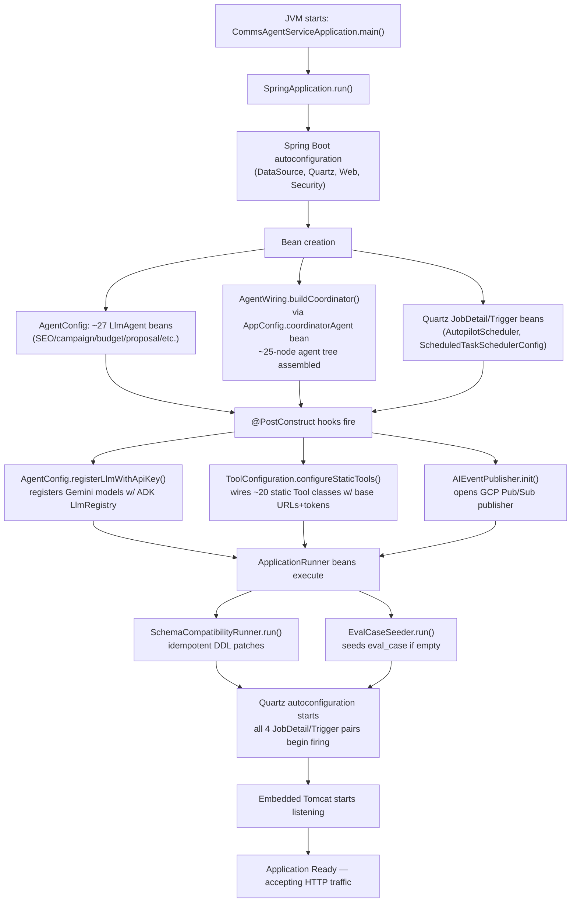
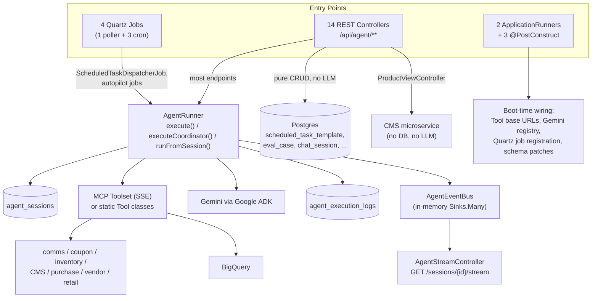
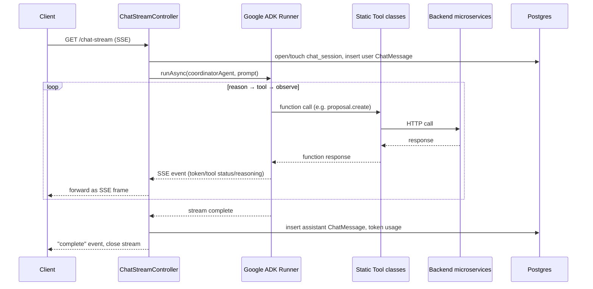
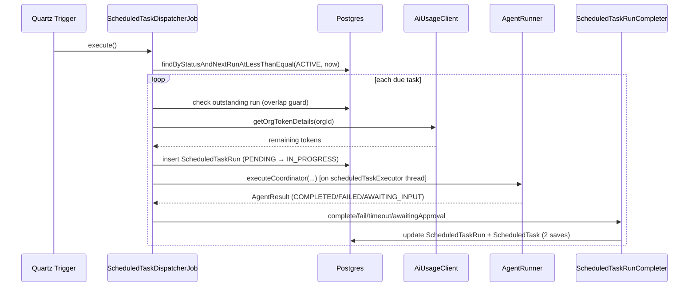

# pallet-comms-agent — Execution Entry Points & Propagation Map

Spring Boot service, package root `com.pallet.agent`, context path `/comms-agent` (`server.servlet.context-path` in `application.yml`), so every path below is also reachable at `/comms-agent` + the path shown. Core orchestration is **Google's Agent Development Kit (ADK)** (`com.google.adk.*`) driving Gemini models — not the raw Anthropic API (Anthropic/OpenAI/Perplexity are used only as narrow "AI search simulation" providers, unrelated to the main chat/agent flow).

---

## Where Does This Service Start?

**Application entry point**: `com.pallet.agent.CommsAgentServiceApplication.main()` → `SpringApplication.run(...)`. Annotated `@SpringBootApplication @EnableAsync @EnableScheduling @ComponentScan("com.pallet.*")`.

**Runtime entry points**, in order of how much traffic they carry:

1. **REST controllers** (14 of them, all under `/api/agent/**`) — the dominant entry point. Most either run an LLM agent synchronously and return the result, or kick off an agent run on a background thread and return `202 Accepted` with a `streamUrl` the client subscribes to separately via SSE.
2. **Quartz scheduled jobs** (4) — `ScheduledTaskDispatcherJob` polls every N seconds (config-driven) for user-created due tasks; `ProposalGenerationJob`/`SeoAuditJob`/`BudgetOptimizationJob` run on fixed cron schedules for "autopilot" restaurants. **Note**: `@EnableScheduling` is declared but there are **no `@Scheduled` methods anywhere in the codebase** — all periodic work goes through Quartz, not Spring's own scheduler.
3. **Application startup hooks** — 2 `ApplicationRunner` beans (`SchemaCompatibilityRunner`, `EvalCaseSeeder`) and 3 `@PostConstruct` methods (`ToolConfiguration.configureStaticTools`, `AgentConfig.registerLlmWithApiKey`, `AIEventPublisher.init`) run once at boot, before the app accepts traffic.
4. **Background/async work** — 3 `@Async` methods (all `AgentLogWriter.save`, `ChatUsageService.persist`, `TokenUsageService.save` — fire-and-forget observability writes off the hot path) plus every `.../stream` controller endpoint's agent run, which is submitted to the `applicationTaskExecutor` thread pool and executes off the original HTTP request thread.
5. **What does NOT exist**: no Kafka/RabbitMQ/SQS/Pub-Sub **consumers** (Pub/Sub usage is publish-only, `AIEventPublisher`), no `@EventListener`/`ApplicationListener`, no Spring Batch, no third-party webhook receivers (the closest analogues — `SeoAgentController`'s website-audit trigger endpoints and `AgentRunController.triggerAgentWithContext` — are internal cross-service triggers, not externally-authenticated webhooks).

## Where Does Execution Propagate?

The dominant pattern, regardless of entry point:

```text
Entry point (Controller / Quartz Job / Tool call from an LLM)
       ↓
AgentRunner.execute(...) / executeCoordinator(...) / runFromSession(...)
       ↓
AgentSession row opened (agent_sessions, @Transactional(REQUIRES_NEW))
       ↓
Per-tenant MCP toolset opened (SSE) OR static Tool classes used directly (coordinator tree)
       ↓
Google ADK InMemoryRunner drives a reason → tool-call → observe loop against Gemini
       ↓
Each step persisted as AgentExecutionLog (async, fire-and-forget)
       ↓
Tool calls hit external microservices (comms/coupon/inventory/CMS/purchase/vendor/retail) or BigQuery
       ↓
AgentSession row updated to terminal status (COMPLETED / AWAITING_INPUT / FAILED)
       ↓
Result returned synchronously, OR streamed via SSE (AgentEventBus → AgentStreamController)
```

A secondary, much simpler pattern covers the handful of endpoints that are pure CRUD against local Postgres tables with no LLM involvement at all (`ScheduledTaskTemplateController`, `EvalCaseController`, `SessionController`'s read endpoints, `ProductViewController`).

## Where Does Execution End?

- **HTTP response** — a JSON body (sync agent run, CRUD endpoints) or a `202 Accepted` with a `streamUrl` (async kickoff), or an open SSE connection that eventually sends a terminal event and closes.
- **Database commit** — `agent_sessions`, `agent_execution_logs`, `scheduled_task`/`scheduled_task_run`, `chat_session`/`chat_message`, `agent_token_usage`, `eval_case`, template/dataset/preview tables.
- **External API response** — MCP tool calls, Gemini completions, GCS uploads, BigQuery queries, the various static Tool classes' calls to comms/coupon/inventory/CMS/purchase/vendor/retail microservices.
- **Exception → GlobalExceptionHandler** — every synchronous failure renders as an RFC-9457 `ProblemDetail`. Failures inside an async/background agent run do **not** produce an HTTP error (the original request already returned 202) — they're recorded on the `AgentSession`/`ScheduledTaskRun` row and surfaced later via polling or SSE.
- **No dead-letter queue, no message ack/nack** — there's no messaging consumer in this service, so those failure modes don't apply here.

---

## 1. Execution Entry Points

| Entry Point | Trigger | Starting Class | Starting Method | What It Does |
|---|---|---|---|---|
| REST — Agent run | HTTP POST | `AgentRunController` | `run()` | Generic sync agent execution, rate-limited |
| REST — Copy enhance | HTTP POST | `AgentRunController` | `enhanceCopy()` | Rewrites marketing copy via `COPY_ENHANCER` agent |
| REST — Generic trigger | HTTP POST | `AgentRunController` | `triggerAgentWithContext()` | Async kickoff for any `AgentType` by name |
| REST — Token usage | HTTP GET ×3 | `AgentMetricsController` | `tokenUsage()`, `tokenUsageByUser()`, `tokenUsageByAgent()` | Read-only usage/cost aggregation |
| REST — Chat history | HTTP GET ×2 | `AgentChatHistoryController` | `listSessions()`, `messages()` | Read-only chat session/message listing |
| REST — Agent SSE | HTTP GET (SSE) | `AgentStreamController` | `stream()` | Subscribes to a live or terminal agent session |
| REST — Audience gen | HTTP POST ×4 | `AudienceAgentController` | `generateSegment*()` | Builds a customer segment (sync + async variants) |
| REST — Audience result | HTTP GET | `AudienceResultController` | `getAudienceResult()` | Reads back a segment-generation session's result |
| REST — Proposals | HTTP POST ×6 | `ProposalAgentController` | `budgetOptimize*()`, `generateProposals*()` | Budget/proposal generation (sync + async) |
| REST — SEO | HTTP POST ×7 | `SeoAgentController` | `seoAudit*()`, `generateKeywords*()`, etc. | SEO audit/keyword/FAQ/competitor agents |
| REST — Sessions | HTTP GET ×5 | `SessionController` | `listSessions()`, `sessionLogs()`, etc. | Read-only session/live-analysis endpoints |
| REST — Scheduled tasks | HTTP ×11 | `ScheduledTaskController` | `create()`, `list()`, `pause()`, etc. | Full scheduled-task CRUD + lifecycle |
| REST — Task templates | HTTP ×5 | `ScheduledTaskTemplateController` | `list()`, `create()`, etc. | Org-scoped template CRUD |
| REST — Eval cases | HTTP ×5 | `EvalCaseController` | `list()`, `create()`, `bulk()`, etc. | Golden-case eval-set CRUD |
| REST — Product view | HTTP GET | `ProductViewController` | `getProduct()` | Deterministic passthrough to CMS, no LLM |
| REST — Chat stream | HTTP GET/POST (SSE) ×6 | `ChatStreamController` | `streamChat()`, `replyToSession()`, etc. | Primary live-chat entry point |
| Scheduled — dispatcher | Quartz poll (config interval) | `ScheduledTaskDispatcherJob` | `execute()` | Dispatches due user-created scheduled tasks |
| Scheduled — proposals | Quartz cron `0 0 0/2 * * ?` | `ProposalGenerationJob` | `execute()` | Every 2h: autopilot proposal generation |
| Scheduled — SEO | Quartz cron `0 0 6 * * ?` | `SeoAuditJob` | `execute()` | Daily 06:00: autopilot SEO audit |
| Scheduled — budget | Quartz cron `0 0 9 ? * MON` | `BudgetOptimizationJob` | `execute()` | Weekly Monday 09:00: autopilot budget reallocation |
| Startup — schema | `ApplicationRunner` | `SchemaCompatibilityRunner` | `run()` | Idempotent DDL patches Hibernate `ddl-auto:update` can't do |
| Startup — eval seed | `ApplicationRunner` | `EvalCaseSeeder` | `run()` | One-time seed of `eval_case` from bundled JSON |
| Startup — tools | `@PostConstruct` | `ToolConfiguration` | `configureStaticTools()` | Wires ~20 static Tool classes with base URLs/tokens |
| Startup — LLM registry | `@PostConstruct` | `AgentConfig` | `registerLlmWithApiKey()` | Registers Gemini models with ADK's `LlmRegistry` |
| Startup — Pub/Sub | `@PostConstruct` | `AIEventPublisher` | `init()` | Opens the outbound token-consumption publisher |
| Tool call (LLM-invoked) | ADK function-call | `com.pallet.agent.tools.*` (28 classes) | `@Schema`-annotated static methods | The LLM's actual "hands" — reach external microservices |

## 2. Application Startup Flow



Notable specifics (not generic Spring boilerplate):
- **No Flyway** — schema is managed by Hibernate `ddl-auto: update`, with `SchemaCompatibilityRunner` patching what `update` mode structurally cannot (relaxing `NOT NULL`, widening `CHECK` constraints, converting `scheduled_task*` PKs from `uuid` to `varchar(64)` for the new `PrefixedSequenceIdGenerator`-based IDs like `TASK-000123`).
- **Quartz jobs are auto-detected**, not manually registered — Spring Boot's Quartz autoconfiguration scans the context for any `JobDetail`/`Trigger` beans and wires them via the single `SpringBeanJobFactory` bean declared in `AutopilotScheduler` (which also autowires dependencies into each `Job` instance on creation).
- **`AgentWiring.buildCoordinator(...)`** assembles the entire ~25-node agent tree (order/inventory/purchase/retail/weather/coupon/campaign/audience/catalog/product/marketing pipelines/data-analyst/scheduled-task/etc.) once, at bean-creation time — this is the tree `ChatStreamController` and `ScheduledTaskDispatcherJob` both drive via `AgentRunner.executeCoordinator(...)`.
- **`EvalCaseSeeder` is idempotent by row-count**, not a flag — it only seeds when `eval_case` is empty, so edits made through the panel survive restarts.

---

## 3. REST API Execution Propagation

All 14 controllers, endpoint by endpoint. Every controller shares the same terminal error path unless noted: **`GlobalExceptionHandler`** (`@RestControllerAdvice`) renders every exception as an RFC-9457 `ProblemDetail` with `code`/`category`/`retryable`/`correlationId`/`timestamp`, sourced from the `ErrorCode` enum catalog via `AgentErrorMapper.classify(ex)`. Handled types: `AgentServiceException` (the domain base type — `.notFound/.forbidden/.validation/.unsupported` factories), legacy `AgentExecutionException`, `MethodArgumentNotValidException`/`ConstraintViolationException`/`IllegalArgumentException` → 400, `MissingServletRequestParameterException` → 400, `HttpMessageNotReadableException` → 400, `MaxUploadSizeExceededException` → 413, `ResponseStatusException` → its own status mapped to a catalog code, catch-all `Exception` → classified (usually 500).

### 3.1 `AgentRunController` — `/api/agent`

| Endpoint | Method chain | DB | External | Sync/Async | Failure |
|---|---|---|---|---|---|
| `POST /run` | `run()` → `UserRateLimiter.tryAcquire()` → `AgentRunner.execute(orgId, locationId, agentType, "manual", message)` → `openSession` (INSERT `agent_sessions`) → `runFromSession` → `AgentResponse.from(AgentResult)` | `agent_sessions` insert+update, `agent_execution_logs` inserts | MCP toolset (SSE), Gemini via ADK | Sync, no SSE | Rate limit → `AgentServiceException(RATE_LIMITED)` → 429; validation → 400; internal agent failures mostly returned as `status=FAILED` in a 200 body, not thrown |
| `POST /copy/enhance` | `enhanceCopy()` → builds fixed prompt → `AgentRunner.execute(..., AgentType.COPY_ENHANCER, "quick_action", prompt)` | same as above | Gemini via ADK (no tools — `COPY_ENHANCER` has empty tool namespace) | Sync | Same pattern, no rate limiter on this endpoint |
| `POST /trigger/{agentType}/{orgId}/{locationId}` | `triggerAgentWithContext()` → `AgentType.fromName(agentType)` → `AgentKickoffService.start(orgId, locationId, type, "internal_trigger", contextJson)` → sync `openSession` + `AgentEventBus.openSink` + submit `runFromSession` to `applicationTaskExecutor` | `agent_sessions` insert (sync) then updates (async, off request thread) | none synchronously; ADK/MCP off-thread | **Fire-and-return**: sync `openSession`+submit, async execution | Unknown `agentType` → `IllegalArgumentException` → 400; failures inside the background run never reach this HTTP response — they land on the session row and surface via SSE |

### 3.2 `AgentMetricsController` — `/api/agent/metrics` (all read-only, sync, no external calls)

| Endpoint | Chain | Table |
|---|---|---|
| `GET /token-usage` | `tokenUsage()` → `TokenUsageService.query()` → `AgentTokenUsageRepository.findAggregated()` + `findTotals()` (JPQL, grouped by date/agentType/model) | `agent_token_usage` |
| `GET /token-usage/by-user` | `tokenUsageByUser()` → `TokenUsageService.byUser()` → `aggregateByUser()` (only rows with non-null `user_id`) | `agent_token_usage` |
| `GET /token-usage/by-agent` | `tokenUsageByAgent()` → `TokenUsageService.byAgent()` → `aggregateByAgent()` | `agent_token_usage` |

Failure: missing/malformed `from`/`to` → 400 or falls to catch-all 500 (no dedicated handler for `MethodArgumentTypeMismatchException`).

### 3.3 `AgentChatHistoryController` — `/api/agent/chat` (read-only, sync)

- `GET /sessions` — `ChatSessionRepository.findByUserIdAndOrgIdAndLocationIdOrderByLastMessageAtDesc(...)` (paged, size capped at 100) on `chat_session`, mapped to local `SessionSummary` record.
- `GET /sessions/{sessionId}/messages` — `ChatHistoryService.transcript(sessionId)` (`@Transactional(readOnly=true)`) → `ChatMessageRepository.findBySessionIdOrderBySeqAsc(...)` on `chat_message`. Unknown session → empty list, not 404.

### 3.4 `AgentStreamController` — `/api/agent` — the SSE subscription endpoint

`GET /sessions/{sessionId}/stream` (SSE, `SseEmitter` not reactive `Flux`, because Tomcat can buffer reactive SSE output — chosen deliberately per the class's own doc comment):
1. `AgentEventBus.hasOpenSink(sessionId)` check against an in-memory `ConcurrentHashMap<UUID, Sinks.Many<...>>`.
2. **No open sink** → `terminalEventFromDb(sessionId)`: `AgentSessionRepository.findById(sessionId)` (1 SELECT on `agent_sessions`), synthesizes a terminal `SESSION_COMPLETED`/`SESSION_FAILED` event from the row's stored `status`/`finalResponse`/`errorMessage`, sends it once, closes.
3. **Open sink** → subscribes to the session's Reactor `Flux`, applies per-event pacing (`pallet.agent.stream.event-pacing-ms`, default 1000ms but meant to be 0 in practice), forwards each `AgentStreamEvent` as an SSE frame until `SESSION_COMPLETED`/`AWAITING_INPUT`/`FAILED` closes the sink (closed by `AgentRunner`, not this controller). 5-minute emitter timeout.
- DB: only the no-sink branch touches the DB (1 SELECT); the live-sink branch is pure in-memory relay.
- Failure: malformed UUID path variable → falls to catch-all 500 (no dedicated `MethodArgumentTypeMismatchException` handler); mid-stream client disconnects are handled internally (`emitter.completeWithError`), never surfaced as an HTTP error since headers are already committed.

### 3.5 `AudienceAgentController` — `/api/agent/audience`

Request DTO: `AudienceGenerateRequest` (record) — `@NotBlank @Size(max=2000) prompt`, `@Size(max=64) locationId`.

| Endpoint | Chain | Async? |
|---|---|---|
| `POST /generate/{orgId}` | `AgentRunner.execute(orgId, request.locationId(), AUDIENCE_GENERATOR, "quick_action", prefix+prompt)` | Sync |
| `POST /generate/{orgId}/{locationId}` | Same, `locationId` from path | Sync |
| `POST /generate/{orgId}/stream` | `AgentKickoffService.start(...)` → sync session-open + sink-open, async `runFromSession` on `applicationTaskExecutor` | Async, 202 + `streamUrl` |
| `POST /generate/{orgId}/{locationId}/stream` | Same, `locationId` from path | Async |

Sub-agent tools scoped to `AUDIENCE_GENERATOR`'s namespace (`audience/customer/data/guardrail`). Failure pattern matches `AgentRunController./run`: most internal failures return `status=FAILED` inside a 200 body rather than an HTTP error; circuit breaker fallback is `mcpUnavailableWithLocation`.

### 3.6 `AudienceResultController` — `/api/agent`

`GET /sessions/{sessionId}/audience-result` — the only controller in the app that reads `AgentExecutionLog.outputPayload` (jsonb) directly and reconstructs a domain answer by hand, with no service layer:
1. `AgentSessionRepository.findById` → 404 (`ResponseStatusException`) if missing.
2. `AgentExecutionLogRepository.findBySessionIdOrderByStepIndexAsc` → scans in-memory for a `data.execute_query` `FUNCTION_RESPONSE` log; if none yet, returns **204 No Content** (a deliberate "not ready" signal, not an error).
3. Resolves segment identity from either `data.find_segment_by_name` (→ `reused=true`) or `data.create_segment` (→ `reused=false`) logs.
4. Hand-assembles a local `AudienceResult` record and returns it.

### 3.7 `ProposalAgentController` — `/api/agent`

Prompts sourced from `QuickActionPrompts` constants. No request-body DTOs — path/query params only.

| Endpoint | AgentType | Async? |
|---|---|---|
| `POST /budget/optimize/{restaurantId}[/{locationId}]` | `BUDGET` | Sync |
| `POST /proposals/generate/{restaurantId}[/{locationId}]` | `PROPOSAL` | Sync |
| `POST /proposals/generate/{restaurantId}/stream` | `PROPOSAL` | Async, 202 |
| `POST /proposals/generate/{restaurantId}/{locationId}/stream` | `PROPOSAL` | Async, 202 — the "new default for the UI" per class Javadoc |

The `PROPOSAL` agent type delegates to sub-agents (`order_analytics_agent`, `inventory_signal_agent`, `customer_insight_agent`, `audience_generator_agent`, `loyalty_insight_agent`, `coupon_agent`) wrapped as ADK `AgentTool`s by `AgentRunner.rebuildWithTools`/`rebuildSubAgentWithScopedTools`. A successful `proposal.create` tool call triggers `StreamEventType.PROPOSAL_CREATED` from inside `AgentRunner`'s `afterToolCallbackSync` — proposal persistence itself happens inside the external MCP tool call, not a local repository write.

### 3.8 `SeoAgentController` — `/api/agent/seo`

| Endpoint | AgentType | Trigger | Async? |
|---|---|---|---|
| `POST /audit/{restaurantId}[/{locationId}]` | `SEO` | `quick_action` | Sync |
| `POST /keywords/generate/{orgId}/{locationId}/stream` | `SEO_KEYWORD_GENERATOR` | `quick_action` | Async |
| `POST /faqs/generate/{orgId}/{locationId}/stream` | `SEO_FAQ_GENERATOR` | `quick_action` | Async |
| `POST /competitor-audit/stream` | `COMPETITOR_AUDITOR` | `internal_trigger` | Async |
| `POST /website-audit/{auditId}/analyze/stream` | `WEBSITE_SEO_AUDITOR` | `internal_trigger` | Async — **self-catches all exceptions and returns an ad hoc `{status, message}` 500 body, bypassing `GlobalExceptionHandler` entirely** (inconsistent with every other endpoint's ProblemDetail shape — flagged in §14) |
| `POST /website-audit/trigger` | `WEBSITE_SEO_AUDITOR` | `internal_trigger` | Async — no self-catch, exceptions propagate normally to `GlobalExceptionHandler` |

`triggerCompetitorAuditStream` uses `CompetitorCitationShareRequestDto` (plain Lombok `@Data` class — consistent with the "no records for DTOs" convention) but the class itself carries no Jakarta validation annotations, so `@Valid` is effectively a no-op there.

### 3.9 `SessionController` — `/api/agent` (all read-only, sync)

- `GET /sessions/{restaurantId}` — `AgentSessionRepository.findByRestaurantId[AndLocationId]OrderByStartedAtDesc(...)`, paged (capped 200), mapped to `SessionSummary`.
- `GET /sessions/{sessionId}/logs` — session lookup + `AgentExecutionLogRepository.findBySessionIdOrderByStepIndexAsc`, mapped to `ExecutionLogDto`; missing session → plain 404 (no body, bypasses `GlobalExceptionHandler` since it's a direct `ResponseEntity.notFound()`, not a thrown exception).
- `GET /sessions/latest/{orgId}[/{locationId}]` — `LiveAnalysisService.latestForOrg[AndLocation]` (`@Transactional(readOnly=true)`): finds the most recent session, walks its execution logs pairing `FUNCTION_CALL`/`FUNCTION_RESPONSE` events into humanized `Finding`s (capped at 8), maps session status → `engineStatus` (`RUNNING→SCANNING`, etc.). Never 404s — returns an `IDLE` shape if no session exists.
- `GET /sessions/{sessionId}/status` — session + logs combined into `SessionDetail`.

### 3.10 `ScheduledTaskController` — `/api/agent/scheduled-tasks` — see §11.2/11.4/11.5/11.6 for full flow detail

11 endpoints; every mutating/read endpoint requires `userId` and checks it via `ScheduledTaskService.getOwnedTask` (403 on mismatch via `AgentServiceException.forbidden`). `POST /` is the external-creation path added on this branch (`creatorType=EXTERNAL_SERVICE` fixed server-side).

### 3.11 `ScheduledTaskTemplateController` — `/api/agent/scheduled-tasks/templates`

Org-scoped only — no per-user ownership check (decision: "caller supplied an orgId" is the only gate today).

| Endpoint | Chain | Notes |
|---|---|---|
| `GET /` | `ScheduledTaskTemplateService.list(orgId)` → `findByOrgIdAndStatusOrderByNameAsc(orgId, ACTIVE)` | Archived templates excluded |
| `GET /{id}` | `.get(id)` → `findById` → `IllegalArgumentException` if missing | 400-ish via `AgentErrorMapper`, not a raw 404 |
| `POST /` | `.create(...)` → builds + saves `ScheduledTaskTemplate` (`@PrePersist` stamps timestamps, `PrefixedSequenceIdGenerator` mints `TPL-000123`) | Returns 200, not 201, despite being a create |
| `PATCH /{id}` | `.update(...)` — **partial-update**: only non-null incoming fields are applied; there's no way to null out a field via this endpoint | |
| `POST /{id}/archive` | `.archive(id)` → sets `status=ARCHIVED`, saves | Soft-delete; 204 |

### 3.12 `EvalCaseController` — `/api/agent/eval/cases` — no service layer, talks straight to `EvalCaseRepository`

| Endpoint | Chain | Notes |
|---|---|---|
| `GET /` | `findAllByOrderBySortOrderAscCreatedAtAsc()` | Full table read |
| `POST /` | Manual validation (`id`/`prompt` required) → `existsById` (409 if duplicate) → `nextSortOrder()` (extra full-table scan) → save | 201 |
| `PUT /{id}` | `findById` (404 if missing) → `applyTo` → re-pin id → save | Body id is ignored — path id wins |
| `POST /bulk` | Per-row forgiving validation — bad rows collected into an `errors[]`, never fails the whole request; **N individual `save()` calls in a loop, not batched** | Always 200 with `{created, updated, failed, errors}` |
| `DELETE /{id}` | `existsById` (404 if missing) → `deleteById` | Hard delete, no soft-delete flag on this entity |

### 3.13 `ProductViewController` — `/api/agent/product/{id}/{locationId}` — no LLM, no DB, pure passthrough

`getProduct()` → static `ProductTool.getProductById(...)` → raw `HttpClient` call to CMS (`GET /product/v2/get/{id}/{locationId}`, bearer service token) → response shaped by local `shape(...)` helper into 200/404/502 depending on the raw string CMS returned (`ProductTool`'s HTTP helpers swallow exceptions into string sentinels rather than throwing, so this rarely reaches `GlobalExceptionHandler`).

### 3.14 `ChatStreamController` — `/api/agent` — the primary live-chat entry point (~3300 lines)

See §11.1 for the full critical-flow trace of `GET /chat-stream`. Other endpoints:
- `POST /sessions/{sessionId}/reply` — resumes a session left `AWAITING_INPUT`: loads parent session (404 if missing, 409 if still `RUNNING`), opens a **child** `AgentSession` synchronously, opens an SSE sink, submits `AgentRunner.continueSession(parent, child, reply, startedAt)` to `taskExecutor`, returns 202.
- `POST /chat-stream/upload-url` — mints a signed GCS PUT URL via `FileIngestionService.mintUploadUrl` so large files bypass the 25MB multipart cap.
- `POST /chat-stream` (SSE) — same coordinator pattern as the GET variant, plus multipart file handling.
- `GET /chat-stream/continue` (SSE) — resumes/continues an existing stream.
- `GET /history` — plain read endpoint.

---

## 4. Method-Level Propagation (deepest chains)

### `AgentRunner.runFromSession(...)` — the `AgentType`-keyed specialist path (used by every non-coordinator controller)

```text
runFromSession(session, agentType, triggerSource, userMessage, startedAt)
    ↓ agentsByType.get(agentType)                         — resolve the LlmAgent bean
    ↓ ServiceTokenProvider.mintServiceToken(...)           — mint outbound service JWT
    ↓ McpToolsetFactory.open(token, orgId, locationId)     — open per-tenant SSE MCP toolset
    ↓ toolset.getTools(...)                                — fetch full tool catalog from MCP server
    ↓ filterTools(allTools, agentType)                     — AgentType.allowsTool(...) namespace filter
    ↓ rebuildWithTools(agent, filtered, ..., beforeToolCb, afterToolCb, onUsage)
        — ADK LlmAgent is immutable; rebuilds a fresh one with per-tenant tools + callbacks +
          UsageTrackingGemini model wrapper + recursively rebuilt sub-agents (wrapped as AgentTool)
    ↓ new InMemoryRunner(agentForRun).runAsync(...).blockingForEach(processEvent)
        — the actual reason→tool→observe loop against Gemini
    ↓ processEvent(...) per ADK Event:
        FUNCTION_CALL      → AgentExecutionLog row queued (async), TOOL_INVOKED SSE event
        FUNCTION_RESPONSE  → AgentExecutionLog row queued, TOOL_COMPLETED (+PROPOSAL_CREATED if
                              tool=="proposal.create") SSE event, metrics.recordToolCall
        TEXT_CONTENT       → buffered as finalResponse if event.finalResponse() && !thought
        EXECUTABLE_CODE / CODE_EXECUTION_RESULT / INLINE_DATA
                           → EXCEL_EXPORT:/chart marker detection → GcsUploadService.uploadBytes
                             → FILE_GENERATED SSE event
    ↓ session.setStatus(COMPLETED|AWAITING_INPUT), sessions.save(session)   — UPDATE agent_sessions
    ↓ tokenUsageService.save(...)                          — async, agent_token_usage
    ↓ eventBus.publish(SESSION_COMPLETED|AWAITING_INPUT|FAILED), eventBus.close(sessionId)
    ↓ return AgentResult
```

**Caller / Called / Input / Output / Side effects** for the hottest hop:
- Caller: any controller's `AgentRunner.execute(...)` overload.
- Called: `openSession` (`@Transactional(REQUIRES_NEW)`) then `runFromSession`.
- Input: `restaurantId, locationId, AgentType, triggerSource, userMessage[, file]`.
- Output: `AgentResult(sessionId, response, status, toolCallCount, totalTokens, durationMs, errorMessage)`.
- Side effects: `agent_sessions` INSERT then UPDATE; N `agent_execution_logs` INSERTs (async); N external tool calls; 0-1 GCS uploads; SSE events published (consumed only if a sink is open).
- Exceptions: caught internally per-run — `failAndStream` marks the session `FAILED`, emits `SESSION_FAILED`, and returns an `AgentResult` with `status=FAILED` rather than throwing, **except** when the resilience4j circuit breaker on the `"mcp"` breaker trips, in which case the corresponding `mcpUnavailable*` fallback method runs instead.

### `AgentRunner.executeCoordinatorInternal(...)` — the coordinator-tree path (`ChatStreamController`, `ScheduledTaskDispatcherJob`, `ScheduledTaskTrialRunService`, `ScheduledTaskApprovalService`)

Key differences from the specialist path: no per-tenant MCP toolset (tools are static Java classes wired once at boot via `ToolConfiguration.configureStaticTools`); tenant scoping is prompt-level only (`tenantConstraintBlock`, a "MANDATORY FILTERING" instruction block prepended to every turn — **there is no tool-level or token-level tenant enforcement for this agent tree**); a fresh `TokenTrackingAgentFactory.rewrite` copy of the shared `coordinatorAgent` bean is used per call so concurrent dispatches don't race on mutable state; a bounded one-shot retry (`looksLikeUnexecutedPlan` regex heuristic) re-prompts the model once if it stated an intent to run a tool but never actually called it — a pattern observed repeatedly on `inventoryAgent`.

---

## 5. Database Propagation

| Flow | DTO in | Entity | Repository method | Table | CRUD |
|---|---|---|---|---|---|
| Agent run (any type) | — | `AgentSession` | `AgentSessionRepository.save` | `agent_sessions` | Create then Update |
| Agent run steps | — | `AgentExecutionLog` | `AgentLogWriter.save` (async) | `agent_execution_logs` | Create (N per run) |
| Token usage | — | `AgentTokenUsage` | `TokenUsageService.save` (async) | `agent_token_usage` | Create |
| Chat turn | `ReplyRequest`/query params | `ChatSession`, `ChatMessage` | `ChatHistoryService.*` | `chat_session`, `chat_message` | Create/Update |
| Scheduled task create | `ScheduledTaskCreateRequest` / tool call | `ScheduledTask` | `ScheduledTaskRepository.save` | `scheduled_task` | Create |
| Scheduled task dispatch | — | `ScheduledTaskRun`, `ScheduledTask` | `ScheduledTaskRunRepository.save`, `ScheduledTaskRepository.save` | `scheduled_task_run`, `scheduled_task` | Create + Update (2 separate saves, no shared transaction) |
| Scheduled task template CRUD | `ScheduledTaskTemplateDto.Request` | `ScheduledTaskTemplate` | `ScheduledTaskTemplateRepository.*` | `scheduled_task_template` | Full CRUD (archive = soft-delete) |
| Eval case CRUD | `EvalCaseDto` | `EvalCase` | `EvalCaseRepository.*` | `eval_case` | Full CRUD (delete = hard delete) |
| Purchase preview cache | — (tool-populated) | `ChatSessionPurchasePreview` | `PurchasePreviewCacheService.*` | `chat_session_purchase_preview` | Create/Update, `@Version` optimistic lock |
| Report dataset | — | `ChatSessionDataset` | `ReportDatasetService.save/find` | `chat_session_dataset` | Create/Read |

Nothing in this service is cached (Spring Cache/Redis/Caffeine) — the closest analogues are the DB-table-backed "last value for this session" rows above (`ChatSessionDataset`, `ChatSessionPurchasePreview`).

---

## 6. External Service Propagation

| Client | Target | Style | Auth |
|---|---|---|---|
| `CommServiceClient` | Comm Service control plane — `GET /api/v1/restaurants?autopilot=true` | Sync, blocking `.block()` | Outbound service JWT via `ServiceTokenProvider` |
| `AiUsageClient` | pallet-business — `POST .../ai-usage/save` (fire-and-forget `.subscribe()`), `GET .../ai-usage/consumption/org` (sync `.block()`, used as a **fail-closed** pre-check by `ScheduledTaskDispatcherJob.isTokenExhausted`) | Mixed | — |
| ~15 static `*Tool` classes (`PurchaseOrderTool`, `VendorTool`, `StockTransferTool`, `CatalogTool`, `CampaignTool`, `CouponTool`, `AudienceTool`, `OfferTool`, `WebsiteBuilderTool`, `ProductTool`, `ProposalTool`, `TemplateTool`, `GuardrailsTool`, `ReturnTool`, `PurchaseIndentTool`, `BigQueryTool`, `ImageGenerationTool`, `GeocodingTool`, `ScheduledTaskTool`) | Various backend microservices (comms/coupon/inventory/CMS/purchase/vendor/retail) + BigQuery + Vertex image gen + Google Maps | Sync, static `WebClient`/`RestTemplate`/raw `HttpClient`, base URLs injected once at boot | Per-tool bearer tokens from `ToolConfiguration.configureStaticTools` |
| MCP toolset (`McpClientConfig.McpToolsetFactory`) | Comm Service's unified MCP server (SSE) | Per-request, tenant-scoped tool-calling channel | `Authorization` + `X-Tenant-Id`/`X-Location-Id`/`X-Org-Type` headers, minted per-run |
| Gemini (via ADK `InMemoryRunner`/`LlmAgent`) | Google's Gemini API | Sync per turn, resilience4j `@CircuitBreaker`/`@Retry` on the `"mcp"` breaker wraps the whole `AgentRunner.execute*` call | API key via `GeminiClientResolver` |
| `ClaudeSearchProvider`/`OpenAiSearchProvider`/`PerplexitySearchProvider`/`GeminiSearchProvider` | Respective "AI search simulation" APIs, used only by `AiSearchScatterService` for a marketing/audience local-search feature | Sync | Provider-specific keys |
| GCS (`GcsUploadService`/`GcsSignedUrlService`) | Google Cloud Storage | SDK calls, not REST | GCP credentials path |

All are synchronous; none of this service's outbound calls are message-queue/event-based.

---

## 7. Event / Message Propagation

**None exists to trace.** No `@KafkaListener`/`@RabbitListener`/`@SqsListener`/`@JmsListener`/GCP Pub/Sub `Subscriber` anywhere in the codebase. The only Pub/Sub usage, `com.pallet.agent.pubsub.AIEventPublisher`, is **publish-only** (AI token-consumption events sent to an external topic) — there is no consumer-side flow, acknowledgement, retry, or dead-letter handling to document because this service never receives messages, only sends them.

---

## 8. Scheduled Job Propagation

| Job | Cron/Interval | Concurrency | Failure handling |
|---|---|---|---|
| `ScheduledTaskDispatcherJob` | `SimpleSchedule`, poll every `pallet.agent.scheduled-tasks.poll-interval-seconds` (config), `repeatForever()` | Per-poll dispatch bounded by `scheduledTaskExecutor` (4-8 threads, `LinkedBlockingQueue`); an overlap guard (`existsByScheduledTaskIdAndStatusIn(PENDING/IN_PROGRESS/AWAITING_APPROVAL)`) skips a task if a run is already outstanding | Per-task try/catch inside `execute()` (one task's failure doesn't stop the poll); `Future.get(maxMinutes, MINUTES)` timeout → `completer.timeout(...)` (best-effort only — the underlying ADK run has no cancellation hook and may keep running/committing in the background); 3 consecutive failures/timeouts → auto-pause (`maybeAutoPause`); missed-poll detection (`nextRunAt` more than one poll interval in the past) → `MISSED` run, schedule still advances |
| `ProposalGenerationJob` | Cron `0 0 0/2 * * ?` (every 2h) | One `AgentRunner.execute` call per autopilot restaurant, sequential, per-restaurant try/catch | Logged and skipped per-restaurant; no retry, no auto-pause (autopilot jobs have no `ScheduledTask`/`ScheduledTaskRun` row — they're not part of the user-facing scheduled-task feature) |
| `SeoAuditJob` | Cron `0 0 6 * * ?` (daily) | Same pattern as above | Same |
| `BudgetOptimizationJob` | Cron `0 0 9 ? * MON` (weekly) | Same pattern as above | Same |

**Transaction boundary**: none of the four jobs wrap their DB writes in a shared transaction spanning the LLM call — `AgentRunner.openSession` is its own `REQUIRES_NEW` transaction, and `ScheduledTaskRunCompleter`'s methods do sequential unguarded `save()` calls (see §14). **No distributed locking** exists for the dispatcher — if two app instances ran concurrently, both could poll the same due task in the same window; the overlap guard only checks for an already-`PENDING`/`IN_PROGRESS` run, which is itself subject to a race between the check and the `INSERT`.

---

## 9. Complete Service Execution Map



---

## 10. Feature-Level Propagation Maps

### FEATURE: Scheduled Task Creation (external/REST path)

```text
Entry Point:  POST /api/agent/scheduled-tasks
Controller:   ScheduledTaskController.create(ScheduledTaskCreateRequest)
Service:      ScheduledTaskService.createTask(CreateTaskCommand{creatorType=EXTERNAL_SERVICE})
Validation:   CONDITIONAL autonomy requires conditionalThresholdDescription;
              exactly one of cronExpression/runAt; computeInitialNextRunAt validates cron/runAt
Persistence:  ScheduledTaskRepository.save → scheduled_task (INSERT)
Final Outcome: 201-shaped response (ResponseEntity.created), task ACTIVE with nextRunAt computed
```

### FEATURE: Scheduled Task Creation (conversational path)

```text
Entry Point:  Chat message → CoordinatorAgent routes to scheduledTaskAgent (rule 19: "schedule/
              automate/recurring/future task")
Tool call:    ScheduledTaskTool.createScheduledTask(...) — static method, LLM-invoked
Service:      ScheduledTaskService.createTask(CreateTaskCommand{creatorType=AGENT})
Persistence:  scheduled_task (INSERT) — same table, same service method as the REST path
Final Outcome: Tool returns a confirmation string to the LLM, which relays it to the user
```

### FEATURE: Scheduled Task Dispatch & Execution

```text
Entry Point:  Quartz poll (ScheduledTaskSchedulerConfig's SimpleTrigger)
Job:          ScheduledTaskDispatcherJob.execute() → findByStatusAndNextRunAtLessThanEqual(ACTIVE, now)
Per task:     dispatch() → overlap guard → missed-check → token pre-check (AiUsageClient,
              fail-closed) → INSERT scheduled_task_run (PENDING) → submit to scheduledTaskExecutor
Business Logic: runInstruction() → handlerRef set? → ScheduledTaskHandlerRegistry (empty today,
              no handlers implemented) : AgentRunner.executeCoordinator(..., approvalInstructionBlock)
Persistence:  ScheduledTaskRunCompleter.complete/fail/timeout/awaitingApproval — 2 separate saves
              (run then task), no shared transaction
External:     Same coordinator tree as live chat — static Tool classes → backend microservices
Final Outcome: Run COMPLETED/FAILED/TIMED_OUT/AWAITING_APPROVAL/MISSED; task's nextRunAt advanced
              or task auto-paused after 3 consecutive failures; GCS output upload (best-effort)
```

### FEATURE: Approval Resolution

```text
Entry Point:  POST /api/agent/scheduled-tasks/{id}/runs/{runId}/approve|reject  (or the equivalent
              ScheduledTaskTool.approveScheduledTaskRun/rejectScheduledTaskRun conversational call)
Service:      ScheduledTaskApprovalService.approve/reject
Approve path: AgentRunner.continueCoordinatorSession(parentSession, ...) — replays conversation
              history + reply through the SAME coordinator agent tree, resuming the AWAITING_INPUT turn
Reject path:  No AgentRunner call at all — run marked CANCELLED, schedule still advances
Persistence:  ScheduledTaskRunCompleter.complete/fail/awaitingApproval/reject
Final Outcome: Draft committed for real (approve) or discarded (reject); schedule advances either way
```

### FEATURE: Autopilot Jobs (Proposal / SEO / Budget)

```text
Entry Point:  Quartz cron trigger (per-job schedule)
Job:          ProposalGenerationJob / SeoAuditJob / BudgetOptimizationJob . execute()
Data source:  CommServiceClient.findAutopilotRestaurants() — GET Comm Service control plane
Per restaurant: AgentRunner.execute(restaurantId, AgentType.PROPOSAL|SEO|BUDGET, "autopilot_*", fixedPrompt)
              — the AgentType-keyed specialist path, NOT the coordinator tree; per-tenant MCP toolset
Persistence:  agent_sessions, agent_execution_logs (same as any AgentRunner.execute call)
Final Outcome: Proposals/audits/reallocations created via MCP tool calls inside the run; job itself
              persists nothing beyond the session/log rows; per-restaurant failures logged and skipped
```

### FEATURE: Live Chat Turn

```text
Entry Point:  GET /api/agent/chat-stream (SSE)
Controller:   ChatStreamController.streamChat()
Business Logic: beginTurn() opens/updates chat_session + records user turn; builds a large
              tenant-constraint + routing prompt; special-cases pasted GCS/public data URLs to
              skip straight to sandbox analysis
Execution:    getAdkRunner(usage).runAsync(...) drives the SAME coordinatorAgent tree as scheduled
              tasks, subscribed reactively; narration vs. final-answer buffering (pendingTurn/
              flushReasoning) because ADK's finalResponse() flag is true for every narration turn too
Persistence:  chat_message (user + assistant turns), agent_token_usage, chat_session_dataset /
              chat_session_purchase_preview (feature-specific caches)
Final Outcome: SSE stream of token/tool-status/reasoning/navigation/suggestion events, closed with
              a "complete" event
```

---

## 11. Critical Flow Tracing

### 11.1 Chat Stream Turn

**Trigger**: User sends a message from the frontend.
**Entry point**: `GET /api/agent/chat-stream?prompt=...&userId=...&orgId=...&locationId=...`

```text
Step 1: ChatStreamController.streamChat() — validates userId/orgId/locationId non-blank,
        rate-limits via UserRateLimiter.tryAcquire(userId)
Step 2: saveOrUpdateSession(userId, sessionId) — UPSERT into user_sessions / chat_session
Step 3: beginTurn(...) — opens/touches ChatSession, records the user's ChatMessage row
Step 4: Builds tenant-constraint prompt block (org/location filtering rules) + effectivePrompt
Step 5: getAdkRunner(ctx.usage).runAsync(userId, sessionId, content, config).subscribe(...)
        — drives the shared coordinatorAgent tree (same tree ScheduledTaskDispatcherJob uses)
Step 6: Per ADK event: functionCalls → sendToolStatus SSE event; functionResponses → sendToolStatus
        + product/purchase preview emitters; text → buffered in pendingTurn, flushed as "reasoning"
        SSE event at the next tool boundary, or as the final answer on stream completion
Step 7: On completion: finalizeTurn(ctx) persists the assistant ChatMessage + token usage;
        emitNavigation/emitSuggestions/emitPurchase* scan the final answer text for trailer markers
Step 8: sendEvent(emitter, "complete", {status: SUCCESS}); emitter.complete()
```



**Failure points**: rate limit → thrown before any DB write; ADK subscription `error` callback → `finalizeTurn` still runs, error surfaced as a token chunk + `sendError` + `emitter.completeWithError`; mid-stream client disconnect → caught in the per-event try/catch, calls `endStream(ctx)`.
**Transaction boundary**: none spans the whole turn — `ChatHistoryService`'s methods are individually `@Transactional`, not wrapped around the ADK run.
**Side effects**: `chat_message` × 2, `agent_token_usage`, possible `chat_session_dataset`/`chat_session_purchase_preview` writes, N external tool calls, 0-1 GCS uploads (charts/Excel).
**Key classes**: `ChatStreamController`, `AgentRunner`/ADK `InMemoryRunner`, `TurnContext`, `AgentEventBus`, `PurchasePreviewCacheService`.

### 11.2 Scheduled-Task Creation (external REST path)

**Trigger**: External service calls the REST API directly (no chat involved).
**Entry point**: `POST /api/agent/scheduled-tasks`

```text
Step 1: ScheduledTaskController.create(ScheduledTaskCreateRequest) — @Valid bean validation
Step 2: Builds CreateTaskCommand with creatorType=EXTERNAL_SERVICE (fixed server-side)
Step 3: ScheduledTaskService.createTask(cmd) — validates CONDITIONAL requires threshold description;
        validates exactly one of cronExpression/runAt
Step 4: computeInitialNextRunAt(...) — Quartz CronExpression.getNextValidTimeAfter, or literal runAt
Step 5: ScheduledTaskRepository.save(task) — INSERT scheduled_task, status=ACTIVE
Step 6: ResponseEntity.created(URI) with ScheduledTaskDto.from(saved)
```

**Failure points**: bean validation (`@NotBlank`/`@NotNull` on the request DTO) → 400; `CONDITIONAL` without threshold or ambiguous cron/runAt → `IllegalArgumentException` → 400; invalid cron syntax → `ParseException` wrapped as `IllegalArgumentException` → 400.
**Transaction boundary**: single `repository.save()` call, no explicit `@Transactional` on `ScheduledTaskService` (flagged in §14).
**Side effects**: one `scheduled_task` row. No agent execution happens at creation time — that's deferred to the dispatcher's next poll.
**Key classes**: `ScheduledTaskController`, `ScheduledTaskCreateRequest`, `ScheduledTaskService`, `ScheduledTaskCreatorType`.

### 11.3 Scheduled-Task Creation (conversational path)

**Trigger**: User asks the chat agent to "schedule" or "automate" something.
**Entry point**: Chat message routed by `CoordinatorAgent`'s instruction rule 19 to `scheduledTaskAgent`.

```text
Step 1: scheduledTaskAgent (LlmAgent, gemini-2.5-flash) interprets the request
Step 2: LLM calls ScheduledTaskTool.createScheduledTask(...) — a static @Schema-annotated method
Step 3: ScheduledTaskTool delegates to the SAME ScheduledTaskService.createTask(cmd),
        creatorType=AGENT this time — static reference wired by ToolConfiguration.configureStaticTools
Step 4: ScheduledTaskRepository.save(task) — identical INSERT path to §11.2
Step 5: Tool returns a plain-text confirmation string, which the LLM relays to the user
```

**Failure points**: same validation as the REST path, but since `ScheduledTaskTool` is invoked by the LLM, an `IllegalArgumentException` surfaces as a tool-call error the model sees and can retry/explain to the user, rather than an HTTP error to a client.
**Key classes**: `ScheduledTaskAgent` (agent definition), `ScheduledTaskTool` (static tool methods), `ScheduledTaskService` (shared with the REST path).

### 11.4 Scheduled-Task Dispatch & Execution

**Trigger**: Quartz `SimpleTrigger` fires every `pollIntervalSeconds`.
**Entry point**: `ScheduledTaskDispatcherJob.execute(JobExecutionContext)`

```text
Step 1: taskRepository.findByStatusAndNextRunAtLessThanEqual(ACTIVE, now) — one query, all due tasks
Step 2: Per task, dispatch(task, now):
Step 3:   Overlap guard — runRepository.existsByScheduledTaskIdAndStatusIn(PENDING/IN_PROGRESS/AWAITING_APPROVAL)
Step 4:   Missed-check — if nextRunAt is older than one poll interval, recordMissed() and skip
Step 5:   Token pre-check — AiUsageClient.getOrgTokenDetails(orgId); fail-closed on error or exhaustion
Step 6:   INSERT ScheduledTaskRun (PENDING) → mark IN_PROGRESS → submit runInstruction(task) to
          scheduledTaskExecutor (bounded 4-8 thread pool)
Step 7:   runInstruction(): handlerRef set? ScheduledTaskHandlerRegistry.find(ref) (empty — throws
          IllegalStateException if referenced but unregistered) : AgentRunner.executeCoordinator(
          orgId, locationId, userId, "scheduled_task", instructionText[, approvalInstructionBlock])
Step 8:   Future.get(maxDurationMinutes, MINUTES) — bounds the wait; TimeoutException → best-effort
          cancellation only (ADK run may keep executing/committing in the background)
Step 9:   ScheduledTaskRunCompleter.complete/fail/timeout/awaitingApproval — 2 separate saves
          (run, then task with nextRunAt/consecutiveFailureCount/status updates), no shared transaction
Step 10:  GcsSignedUrlService.uploadObject(outputText) — best-effort, silently no-ops if
          report.gcs.bucket is unset
Step 11:  ScheduledTaskNotifier.notify(...) — currently a LOGGING STUB, no real channel wired
```



**Failure points**: per-task try/catch in `execute()` so one crash doesn't halt the poll; `TimeoutException` cannot actually stop the underlying ADK execution (no cancellation hook — documented risk); 3 consecutive failures/timeouts auto-pauses the task.
**Transaction boundary**: **none spans a full dispatch** — `ScheduledTaskRun` and `ScheduledTask` are saved in two separate, unguarded calls inside `ScheduledTaskRunCompleter`; a crash between them could leave the pair inconsistent (flagged in §14).
**Side effects**: `scheduled_task_run` insert+update, `scheduled_task` update, N external tool calls via the coordinator tree, optional GCS upload, log-only notification.
**Key classes**: `ScheduledTaskDispatcherJob`, `ScheduledTaskRunCompleter`, `ScheduledTaskHandlerRegistry`, `AiUsageClient`, `AgentRunner`.

### 11.5 Approval Resolution

**Trigger**: A human reviews a draft left `AWAITING_APPROVAL` by an `APPROVAL_REQUIRED`/`CONDITIONAL` scheduled task.
**Entry point**: `POST /api/agent/scheduled-tasks/{id}/runs/{runId}/approve` (or `.../reject`), or the equivalent `ScheduledTaskTool.approveScheduledTaskRun`/`rejectScheduledTaskRun` conversational call.

```text
Step 1: ScheduledTaskController.approveRun()/rejectRun() → ScheduledTaskApprovalService.approve/reject
Step 2: taskService.getOwnedTask(taskId, userId) — 403 on mismatch
Step 3: getAwaitingApprovalRun(task, runId) — validates run belongs to task and is AWAITING_APPROVAL
Step 4 (approve): AgentSessionRepository.findById(run.getAgentSessionId()) — loads the parent session
Step 5 (approve): AgentRunner.continueCoordinatorSession(parentSession, orgId, locationId, userId, reply)
        — replays buildConversationHistory(parentSession) + the reply through the SAME coordinator tree
Step 6 (approve): result routed to ScheduledTaskRunCompleter.complete/fail/awaitingApproval depending
        on the new AgentResult.status()
Step 7 (reject): No AgentRunner call — ScheduledTaskRunCompleter.reject() marks run CANCELLED directly
```

**Failure points**: run not `AWAITING_APPROVAL` → `AgentServiceException.validation` → 400; a typed-handler run (`run.getAgentSessionId() == null`) → `AgentServiceException.unsupported` (no handler-continuation mechanism exists yet); a further `AWAITING_INPUT` result (e.g. a `CONDITIONAL` rule firing again) keeps the run in `AWAITING_APPROVAL`, now pointed at the new session/turn.
**Transaction boundary**: same gap as §11.4 — `ScheduledTaskRunCompleter`'s saves are unguarded.
**Side effects**: the approved action actually commits for real this time (the draft's held-back tool call executes); token counts are summed across the original draft run and the approval turn.
**Key classes**: `ScheduledTaskApprovalService`, `AgentRunner.continueCoordinatorSession`, `ScheduledTaskRunCompleter`.

### 11.6 Trial Run

**Trigger**: `POST /api/agent/scheduled-tasks/{id}/trial-run` (or the `trialRunScheduledTask` tool call).
**Entry point**: `ScheduledTaskController.trialRun()` → `ScheduledTaskTrialRunService.estimate(taskId, userId)`

```text
Step 1: ScheduledTaskService.trialRunEstimate(taskId, userId) — checks for prior COMPLETED,
        non-trial runs via runRepository.findByScheduledTaskIdAndIsTrialRunFalseAndStatus(...)
Step 2a (history exists): returns a free average (tokens/duration) — no execution, no new row
Step 2b (no history): executeFreshTrialRun() — submits AgentRunner.executeCoordinator(...,
        forcedDraftInstructionBlock()) to scheduledTaskExecutor, bounded by Future.get(maxMinutes)
Step 3: forcedDraftInstructionBlock() is UNCONDITIONAL — unlike the dispatcher's approvalInstructionBlock
        (which only applies to APPROVAL_REQUIRED/CONDITIONAL tasks), a trial run never commits a real
        side effect regardless of the task's own autonomyMode
Step 4: ScheduledTaskRunCompleter.saveTrialRun(trialRun, outputText) — persists a ScheduledTaskRun
        with isTrialRun=true; deliberately does NOT touch the parent ScheduledTask at all
```

**Failure points**: `TimeoutException` → returns `available=false` with an explanatory message (no partial row saved as a real failure); unexpected exception → same graceful degradation.
**Transaction boundary**: single `saveTrialRun` call, no cross-entity transaction needed (parent task untouched by design).
**Side effects**: at most one `scheduled_task_run` row (`isTrialRun=true`), excluded from the dispatcher's due-tasks query and from circuit-breaker failure counting.
**Key classes**: `ScheduledTaskTrialRunService`, `ScheduledTaskService.trialRunEstimate`, `ScheduledTaskRunCompleter.saveTrialRun`.

### 11.7 Autopilot Job (Proposal example — SEO/Budget are structurally identical)

**Trigger**: Quartz cron `0 0 0/2 * * ?` (every 2 hours).
**Entry point**: `ProposalGenerationJob.execute(JobExecutionContext)`

```text
Step 1: CommServiceClient.findAutopilotRestaurants() — GET Comm Service, blocking .block()
Step 2: Per restaurant, try { AgentRunner.execute(r.id(), AgentType.PROPOSAL, "autopilot_proposals",
        fixedPrompt) } catch (Exception e) { log and continue }
Step 3: AgentRunner.execute (5-arg overload) → openSession → runFromSession — the AgentType-keyed
        specialist path (own per-tenant MCP toolset), NOT the coordinator tree
```

**Failure points**: per-restaurant try/catch — one restaurant's failure doesn't stop the batch; no retry, no notification, no `ScheduledTaskRun` row (autopilot is not part of the user-facing scheduled-task feature — it has no pause/resume/history UI).
**Transaction boundary**: `openSession`'s own `REQUIRES_NEW` transaction only.
**Side effects**: `agent_sessions`/`agent_execution_logs` per restaurant; proposals created via MCP `proposal.create` tool calls inside each run.
**Key classes**: `ProposalGenerationJob`/`SeoAuditJob`/`BudgetOptimizationJob`, `CommServiceClient`, `AgentRunner.execute`.

### 11.8 Tool-Calling Round-Trip

**Trigger**: mid-run, inside any `AgentRunner` execution, whenever the LLM decides to call a tool.

```text
Step 1: ADK's Gemini turn returns a FunctionCall part
Step 2: BeforeToolCallbackSync fires synchronously — publishes TOOL_INVOKED SSE event, captures
        justification (last reasoning text)
Step 3: The actual tool method executes:
          - Specialist path: an MCP tool (implemented server-side by the Comm Service's MCP server,
            reached over the per-tenant SSE toolset opened in Step 5 of §4's runFromSession trace)
          - Coordinator path: a static Java method on one of the tools/*.java classes (e.g.
            PurchaseOrderTool.createExpressPurchaseOrder), which makes its own outbound HTTP call to
            a backend microservice using the base URL/token wired at boot
Step 4: AfterToolCallbackSync fires synchronously — publishes TOOL_COMPLETED SSE event, records
        metrics.recordToolCall(agentType, toolName, ok), and for proposal.create specifically also
        publishes PROPOSAL_CREATED
Step 5: The tool's response is fed back into the ADK conversation as a FunctionResponse, and the
        loop continues (another tool call, or a final text answer)
```

**Failure points**: a tool returning `{"error": ...}` is recorded as `ok=false` in metrics but does NOT throw — the LLM sees the error in the function response and decides how to react (retry, apologize, try a different tool); a genuine exception inside a static Tool class's HTTP call is typically caught internally and returned as an error-shaped string/map (see `ProductTool`'s pattern in §3.13), not thrown up through ADK.
**Key classes**: `AgentRunner`'s `beforeToolCb`/`afterToolCb` lambdas, the ~28 classes under `tools/`, `AgentMetrics`.

---

## 12. Mental Model of This Service

**"If I send a chat-stream request, what happens end to end?"** The HTTP GET opens an SSE connection immediately (before any LLM work starts) and pushes a `session` event with a generated `sessionId`. The controller then builds a large tenant-scoping prompt and hands it to a shared, pre-assembled ~25-agent coordinator tree (built once at startup, but a fresh copy rebuilt per call so concurrent users don't share mutable state). The coordinator LLM decides which specialist sub-agent(s) to delegate to, and those sub-agents call static Java tool methods that in turn make real HTTP calls to backend microservices (comms, purchase, inventory, etc.) or run BigQuery SQL. Every tool call and text chunk streams back to the browser in near-real-time as SSE events. When the model produces its final answer (recognizable because *nothing follows it* — no further tool call or narration), that's flushed as the answer, chat history is persisted, and the stream closes.

**"If a scheduled task fires, what happens?"** A background Quartz thread — not any user's HTTP request — wakes up on a fixed interval, queries Postgres for due tasks, and for each one either invokes a typed handler (currently none exist) or replays the task's saved natural-language instruction through the *exact same* coordinator agent tree the live chat uses, just with no human watching. If the task requires approval, the model is instructed to stop short of committing and prefix its answer with `[AWAITING_INPUT]`; a human later resumes that exact ADK session via a REST call or a follow-up chat message, and the *same* conversation continues from where it paused.

**"If the app starts up, what happens?"** Before any HTTP traffic is accepted: ~27 `LlmAgent` beans and the ~25-node coordinator tree are assembled in memory (no external calls yet — these are just prompt/config objects); `@PostConstruct` hooks wire ~20 static tool classes with their microservice base URLs and register Gemini model factories with ADK; then two `ApplicationRunner`s run once — one patches schema quirks Hibernate's `ddl-auto:update` can't handle, the other seeds a golden eval-case table if empty. Quartz's own autoconfiguration then starts firing the 4 registered jobs on their configured schedules, and Tomcat starts accepting connections.

**"If an external service calls back (e.g. a website-audit trigger)?"** There's no real inbound webhook auth here — these are same-org internal HTTP calls from another Pallet service, hitting the same kickoff pattern as a user-triggered async endpoint: open a session, open an SSE sink, submit the run to the background executor, return 202. The "callback" is really just another async trigger source (`internal_trigger` instead of `quick_action`/`manual`).

---

## 13. Dependency Direction

**Healthy, expected direction** for the vast majority of the codebase:

```text
Controller → Service → Repository → Database
Controller → AgentRunner → (MCP toolset | static Tool classes) → external microservice
```

**Deviations worth calling out**:

- **Static tool classes hold service references injected via `@PostConstruct`, not constructor DI.** `ScheduledTaskTool.setTaskService(...)`/`setTemplateService(...)`/etc. are called from `ToolConfiguration.configureStaticTools()` at boot, because ADK's tool-calling convention (`FunctionTool.create(ToolClass.class, "methodName")`) requires **static** methods, which can't receive constructor-injected Spring beans. This inverts normal DI — a config class reaches *into* a non-Spring-managed class and sets its static fields — and means every static tool class carries process-wide mutable state shared across all tenants/requests (functionally fine since the values are set once at boot and never change per-request, but worth knowing if a test ever needs to swap one out).
- **`ChatStreamController` (~3300 lines) does a large amount of business logic that would normally live in a service** — prompt construction, marker parsing (`VIZ_MARKER`, `FORECAST_*_MARKER`, `SUGGESTIONS_MARKER`, `NAVIGATION_MARKER`), file/URL handling, and direct manipulation of `PurchasePreviewCacheService`/`ReportDatasetService`. This is a controller-holds-too-much-logic pattern (see §14).
- **`ProductViewController` bypasses the service layer entirely**, calling the static `ProductTool` directly with no `@Service` in between — deliberate (documented as "no LLM, no chat stream" in the class), but it's the only controller in the app with this shape.
- **`AudienceResultController` reads two repositories directly with no service layer**, hand-parsing `jsonb` payloads inline in the controller.
- No circular dependencies or reverse-direction calls (Repository → Controller, Entity → Client) were found.

---

## 14. Propagation Problems

1. **`ScheduledTaskService`/`ScheduledTaskApprovalService`/`ScheduledTaskRunCompleter` have no `@Transactional` boundaries**, despite multi-entity mutations. `ScheduledTaskRunCompleter.complete(...)` saves a `ScheduledTaskRun` and then, separately, a `ScheduledTask` — a crash between the two saves leaves the pair inconsistent (e.g. a run marked `COMPLETED` but the task's `nextRunAt` never advanced, causing it to be rediscovered as "due" indefinitely — this exact failure mode is what `SchemaCompatibilityRunner`'s comments describe having happened in practice with a `NOT NULL` constraint).
2. **`SeoAgentController.triggerWebsiteAuditAnalysisStream` bypasses `GlobalExceptionHandler`** — it self-catches and returns an ad hoc `{status, message}` 500 body instead of the RFC-9457 `ProblemDetail` shape every other endpoint produces, making client-side error handling inconsistent for this one route.
3. **`ScheduledTaskHandlerRegistry` ships empty** — the "typed, non-LLM handler" escape hatch (`ScheduledTask.handlerRef`) has no implementations yet; any task somehow created with a `handlerRef` set would throw `IllegalStateException` at dispatch time.
4. **`ScheduledTaskNotifier` is a logging stub** — every dispatcher notification (`COMPLETED`, `FAILED`, `MISSED`, `AUTO_PAUSED`, `TOKENS_EXHAUSTED`, `TIMED_OUT`, `APPROVAL_REQUIRED`) is only ever written to the application log, never delivered to an actual user-facing channel.
5. **`AiUsageClient.save` is fire-and-forget** (`.subscribe()` with no error handler visible in the trace) — a failed usage-recording call is silently lost, no retry, no alert.
6. **Timeout cancellation is best-effort only** — `ScheduledTaskDispatcherJob`'s `Future.get(maxMinutes, MINUTES)` timeout cannot actually stop the underlying ADK/Gemini call; the background execution may keep running and even commit real side effects after the dispatcher has already recorded the run as `TIMED_OUT`. This is a documented, accepted risk in the code, not an oversight — but worth knowing when debugging "the task says it timed out but the order was still created."
7. **No distributed lock on the scheduled-task poll** — if this service ever runs with more than one instance, the overlap guard (`existsByScheduledTaskIdAndStatusIn`) is a check-then-act race, not an atomic claim; two instances could both dispatch the same due task in the same poll window.
8. **All Spring Security endpoints are `permitAll()`** (`SecurityConfig.securityFilterChain`) — every authorization decision in this service is manual/service-level (`ScheduledTaskService.getOwnedTask`'s `userId` equality check, `ScheduledTaskTemplateController`'s bare `orgId` gate with no ownership check at all). There is no role-based or resource-level enforcement at the framework layer.
9. **`WebClient` is used almost everywhere with `.block()`**, defeating its reactive/non-blocking purpose — every external HTTP call through the static tool classes and `CommServiceClient`/`AiUsageClient` (except the one fire-and-forget usage-save call) ties up a request thread while waiting.
10. **Two inconsistently-named repository packages** — `com.pallet.agent.repository` (most entities) vs. `com.pallet.agent.repositories` (`AdkSessionState`, `UserSession`) — purely a naming inconsistency, no functional impact, but a trap for anyone searching by package.
11. **`ChatStreamController` is ~3300 lines** with prompt-building, marker-parsing, file handling, and cache-service orchestration all inline — a strong candidate for extraction into dedicated services (some of this decomposition has already happened for other controllers per the "Phase 1 decomposition" comments referencing `AudienceAgentController`/`SessionController` having been split out of an earlier monolithic `AgentController`).
12. **`EvalCaseController.bulk()` saves N rows in an uncommitted, unbatched loop** — no `@Transactional`, no batch insert; a mid-loop failure leaves a partial bulk-import committed with no rollback.

---

## 15. Developer Trace Exercises

### Exercise 1 — Trace a synchronous agent run
Call `POST /api/agent/copy/enhance` with a small `CopyEnhanceRequest` body. In the logs, follow: `AgentRunController.enhanceCopy` → `AgentRunner.execute` (`[STEP 1/10]` through `[STEP 10/10]` log lines are printed by `AgentRunner` itself) → note there's no MCP tool involved (`COPY_ENHANCER` has an empty tool namespace) → confirm the `agent_sessions` row's `status` ends `COMPLETED` and `tool_call_count = 0`.

### Exercise 2 — Trigger the scheduled-task dispatcher and trace it
Create a task via `POST /api/agent/scheduled-tasks` with `runAt` a minute in the future and `autonomyMode=AUTONOMOUS`. Watch the logs for `[SCHEDULED-TASK]` lines from `ScheduledTaskDispatcherJob` on the next poll after `runAt` passes. Confirm a `scheduled_task_run` row appears (`PENDING` → `IN_PROGRESS` → `COMPLETED`), then that `scheduled_task.next_run_at` becomes `null` and `status` becomes `COMPLETED` (one-off task) via `ScheduledTaskRunCompleter.advanceOrComplete`.

### Exercise 3 — Watch an approval round-trip
Create a task with `autonomyMode=APPROVAL_REQUIRED` whose instruction would normally commit something (e.g. create a coupon). After it dispatches, confirm the run lands in `AWAITING_APPROVAL` with a `[AWAITING_INPUT]`-prefixed summary in `handler_result_summary`. Call `POST /api/agent/scheduled-tasks/{id}/runs/{runId}/approve` and confirm `AgentRunner.continueCoordinatorSession` re-enters the *same* ADK session (check the log's `sessionId` matches the original draft's) and the run transitions to `COMPLETED`.

### Exercise 4 — Force an external-call failure and observe propagation
Temporarily point `services.comms.base-url` (or another `services.*.base-url` property) at an unreachable host, then call an endpoint whose agent uses that tool namespace (e.g. `POST /api/agent/seo/audit/{restaurantId}`). Observe that the tool call returns an error-shaped response rather than throwing — the LLM sees the failure and typically apologizes/reports it in its final answer rather than the HTTP call itself failing; the session still completes with `status=COMPLETED` (or occasionally `FAILED` if the model gives up entirely).

### Exercise 5 — Debug a live chat-stream turn with breakpoints
Set breakpoints in `ChatStreamController.streamChat` at the `runAsync(...).subscribe(event -> {...})` lambda's `if (event.functionCalls() ...)` branch and at the `finalizeTurn(ctx)` call in the `onComplete` handler. Send a prompt that requires a tool call (e.g. "how many orders today"). Step through: confirm `flushReasoning` fires before the tool-status event, confirm `pendingTurn` accumulates the final answer text, and confirm `chat_message` gets a new row only in `finalizeTurn`, not per-token.

---

## 16. Final "Start Here" Runtime Guide

### If I Have Only 2 Hours
Read `AgentRunner.java` top to bottom (it's the single most load-bearing class — every REST controller and every scheduled job eventually calls into it) and `ScheduledTaskDispatcherJob.java` (the clearest worked example of the full create → dispatch → complete lifecycle). Skim §3's table for the controller you're most likely to be paged about.

### If I Have 1 Day
Add: `ChatStreamController`'s `streamChat()` method (the highest-traffic entry point), `AgentWiring.java` + one or two `agents/*.java` factory classes to see how the coordinator tree and its instructions are actually built, `ScheduledTaskService`/`ScheduledTaskRunCompleter`/`ScheduledTaskApprovalService` together (the full scheduled-task business logic), and `GlobalExceptionHandler` + `ErrorCode` (so you recognize every error shape the API can return). Run Exercises 1-3 above locally.

### If I Have 1 Week
Priority order, per the 10 areas below:
1. **Runtime understanding** — everything above, plus `AgentEventBus`/`AgentStreamController` (the SSE relay mechanism) and `McpClientConfig` (the per-tenant MCP toolset).
2. **Critical business flows** — all 8 flows in §11, especially the scheduled-task lifecycle since it's the actively-developed feature on this branch.
3. **Database** — read `V1`-`V8` migration SQL files in `db/migration/`, cross-reference against §5's table, note that Hibernate `ddl-auto:update` is the actual source of truth (not the migration files) and `SchemaCompatibilityRunner` patches what it can't do.
4. **External integrations** — skim 3-4 of the `tools/*.java` classes to see the static-wiring pattern, then `ToolConfiguration.configureStaticTools()` to see every base URL/token this service depends on.
5. **Background processing** — all 4 Quartz jobs (§8), and the `applicationTaskExecutor`/`agentLogExecutor`/`scheduledTaskExecutor` thread pool configs.
6. **Failure handling** — §14 in full; this is the fastest path to understanding what's fragile.
7. **Performance** — note the pervasive `.block()` usage on `WebClient` (problem #9), and that MCP toolsets are opened fresh per specialist-path run (no connection pooling visible in the trace).
8. **Security** — `SecurityConfig`'s `permitAll()` + `ServiceJwtAuthFilter`/`ServiceTokenProvider` pair (inbound vs. outbound service JWTs), and the manual ownership checks scattered through the service layer.
9. **Technical debt** — §13/§14 together.
10. **Improvement opportunities** — the empty `ScheduledTaskHandlerRegistry`, the stub `ScheduledTaskNotifier`, and the missing transaction boundaries in §14 are the three highest-leverage gaps if this feature area gets more investment.

**After this guide**: given a ticket against this service, you should be able to identify within minutes whether it touches the REST/CRUD layer (§3), the agent-orchestration layer (§4/§11), the scheduled-task subsystem (§10/§11.2-11.6), or an external-integration failure (§6/Exercise 4) — and know exactly which class to put a breakpoint in first.
